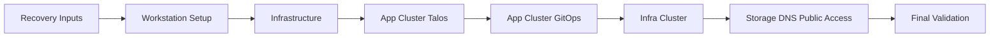

# 🏠 home-dc-kubernetes



This repository is the rebuild source of truth for the Kubernetes homelab. It
manages the Talos app cluster, the physical infra cluster, Argo CD GitOps, and
Kubernetes manifests. OpenTofu infrastructure is managed in `../home-dc-terraform`;
host configuration is managed in `../home-dc-proxmox`.

The rebuild flow is staged in the same spirit as the upstream
[`ajaykumar4/cluster-template`](https://github.com/ajaykumar4/cluster-template):
prepare hardware, prepare the workstation, render configuration, bootstrap
Talos, bootstrap Argo, then verify GitOps.

## 🎯 Target State

| Cluster       | Argo name       | Platform             | Role                              |
| ------------- | --------------- | -------------------- | --------------------------------- |
| App cluster   | `app-cluster`   | Talos VMs on Proxmox | Argo CD hub and general workloads |
| Infra cluster | `infra-cluster` | Physical Talos nodes | Core infra services and monitors  |

The app cluster runs as one controller and three workers; the infra cluster is
an independent two-node physical cluster that is not changed by app-cluster
rebuilds. Argo CD runs on `app-cluster` and manages both clusters. The
cluster-aware app layout is:

```text
kubernetes/argo/apps/app-cluster/<namespace>/*.yaml
kubernetes/argo/apps/infra-cluster/<namespace>/*.yaml
kubernetes/apps/app-cluster/<namespace>/<app>/
kubernetes/apps/infra-cluster/<namespace>/<app>/
```

## 🛤️ Stage 0: Recovery Inputs

Before rebuilding, recover or recreate these local-only inputs. They must not be
committed:

```text
age.key
kubeconfig
.private/infra-cluster/kubeconfig
.private/infra-cluster/generated/
```

Recovery sources for each input:

-   `age.key`: restore from your password manager or backup. If it is lost,
    generate a new key, update `.sops.yaml` with the new recipient, and
    re-encrypt every `*.sops.yaml` file (`task template:encrypt-secrets`).
-   `kubeconfig` (app cluster): restore from backup. If the cluster still exists,
    fetch a fresh kubeconfig with `task talos:app:kubeconfig` after
    authenticating to Talos.
-   `.private/infra-cluster/kubeconfig`: restore from backup. If the infra
    cluster still exists, regenerate it with `task talos:infra:kubeconfig`.
-   `.private/infra-cluster/generated/`: restore the whole directory from backup.
    It contains the infra-cluster Talos identity bundle. If it is lost,
    regenerate machine configs and secrets from `talos/infra/` with
    `task talos:infra:bootstrap`; this creates a new cluster identity and the
    old one is unrecoverable.

For infra-cluster recovery, `.private/infra-cluster/generated/` is the physical
cluster identity bundle. Keep the whole directory, not only `talosconfig`, when
recovering existing infra nodes.

Also confirm access to:

-   Proxmox, if rebuilding the app-cluster VMs
-   Cloudflare account, DNS zone, and tunnel credentials
-   Doppler project `home-dc-kubernetes` with configs `apps` and `infra`
-   GitHub deploy key or repository credentials for Argo CD
-   NAS NFS export at `10.0.40.2:/media` for media workloads

App-cluster VM disks and Proxmox host configuration are owned by the standalone
infrastructure repositories (`home-dc-proxmox` and `home-dc-terraform`). This
repository owns Talos, Kubernetes, and GitOps manifests.

If local inputs are unavailable, follow the documented Talos and cluster
recovery procedures; this repository does not provision infrastructure.

## 🛤️ Stage 1: Workstation

Clone the repo outside iCloud-synced folders, then install the pinned tools. This
stage prepares the operator workstation for both recovery of an existing cluster
and a fresh build:

```bash
git clone git@github.com:fabricesemti80/home-dc-kubernetes.git
cd home-dc-kubernetes
nix develop
task deps
```

Check required secrets and local config:

```bash
test -f age.key
test -f .sops.yaml
test -f kubernetes/apps/app-cluster/doppler-operator-system/doppler-operator/config/secret-apps.sops.yaml
test -f kubernetes/apps/infra-cluster/doppler-operator-system/doppler-operator-infra/config/secret-infra.sops.yaml
task secrets:validate-bootstrap
task --list
```

If using direnv, allow the repo-local age key export:

```bash
direnv allow .
echo "$SOPS_AGE_KEY_FILE"
```

Useful docs:

-   [docs/README.md](docs/README.md)
-   [docs/cluster/README.md](docs/cluster/README.md)
-   [docs/cluster/dual-cluster-management.md](docs/cluster/dual-cluster-management.md)
-   [docs/cluster/secret-strategy.md](docs/cluster/secret-strategy.md)

## 🏗️ Stage 2: Infrastructure

The standalone guest VMs are provisioned from `../home-dc-terraform`. Review its
`task nodes-plan` and apply only an explicitly reviewed plan; verify the three
dedicated worker data disks and primary NICs before configuring Talos.
`../home-dc-proxmox` manages the physical host.

Cloudflare tunnel and Access infrastructure is managed from
`../home-dc-terraform`. Local DNS is served by Technitium; Kubernetes
`ExternalDNS` handles application records declared through GitOps. This
repository contains no OpenTofu roots or infrastructure plan/apply tasks.

Do not bootstrap or reprovision the unchanged physical infra-cluster.

Useful docs:

-   [talos/README.md](talos/README.md)
-   [talos/infra/README.md](talos/infra/README.md)

## ☸️ Stage 3: App Cluster Talos

For the **fresh, maintenance-mode app cluster only**, the bootstrap task generates machine configs, applies them insecurely to the four nodes, bootstraps etcd once and fetches a kubeconfig:

```bash
task talos:app:bootstrap
```

Do not run `task template:configure` as a routine rebuild step. It re-renders
repository templates and may need bootstrap-only secrets from the
`home-dc-kubernetes/apps` Doppler config; use it only when intentionally regenerating
templated source files.

Compatibility aliases still exist:

```bash
task talos:genconfig
task talos:bootstrap
```

After the one-time Talos bootstrap, install Cilium via the task before expecting
nodes to become Ready:

```bash
task bootstrap:network
kubectl --kubeconfig ./kubeconfig get nodes -o wide
talosctl --talosconfig talos/app/clusterconfig/talosconfig get members
```

## ☸️ Stage 4: App Cluster GitOps

The Helmfile bootstrap installs only foundational components. Argo CD remains
the deployment controller for application workloads. Keep application sync
disabled until the per-app fresh-start/restore decisions are recorded and the
reviewed refactor is merged into remote `main` (all Argo Applications track
`main`; syncing earlier deploys the retired Ceph manifests):

```bash
task bootstrap:platform
task clusters:register-infra # Only with approval for the existing infra Argo RBAC
task secrets:validate-bootstrap
# After merging this refactor into remote main:
task apps:bootstrap
task reconcile
```

`task reconcile` requests a hard refresh through the cluster kubeconfig. Argo
auto-syncs applications from Git, including the KubeVirt test stack.

Before syncing, confirm both scoped Doppler operator token Secrets are present
in Git and decryptable:

```bash
task secrets:validate-bootstrap
```

Watch convergence:

```bash
kubectl get pods -A --watch
kubectl get applications.argoproj.io -n argo-system
```

The root Argo app should be `Synced` and `Healthy`:

```bash
kubectl get application apps -n argo-system
```

## ☸️ Stage 5: Verify Existing Infra Cluster

The two physical infra-cluster nodes are unchanged by this migration. Do **not** rerun infra Talos bootstrap, Cilium installation or kubeconfig generation. Verify their existing health read-only and confirm the app-cluster Argo hub still targets the registered `infra-cluster` destination:

```bash
kubectl --kubeconfig .private/infra-cluster/kubeconfig get nodes -o wide
kubectl --kubeconfig .private/infra-cluster/kubeconfig get pods -A
kubectl get applications.argoproj.io -n argo-system
```

## 💾 Stage 6: Storage, DNS, and Public Access

Verify storage before restoring stateful workloads:

```bash
kubectl get storageclass
kubectl get pvc -A
kubectl get pv
kubectl get application local-path -n argo-system
kubectl get pv media-library-pv
```

The app cluster uses:

-   `local-path` StorageClass for node-local app config/state PVCs (`ReadWriteOnce`, `Retain`).
-   Static NFS PV/PVC (`media-library-pv` / `media-library-pvc`) at `10.0.40.2:/media` for media/downloads.

Do not restore stateful apps until the bound worker node, volume node affinity,
and any required backup data have been verified.

Verify public and internal routing:

```bash
kubectl get httproute -A
kubectl get dnsendpoint -A
kubectl get application cloudflare-dns cloudflare-tunnel cloudflare-tunnel-infra -n argo-system
```

Verify Doppler runtime secret sync after Argo converges:

```bash
kubectl -n doppler-operator-system get dopplersecret
kubectl --kubeconfig .private/infra-cluster/kubeconfig -n doppler-operator-system get dopplersecret
```

Useful docs:

-   [docs/storage/overview.md](docs/storage/overview.md)
-   [docs/cluster/domains.md](docs/cluster/domains.md)
-   [docs/monitoring/uptime-kuma-autokuma.md](docs/monitoring/uptime-kuma-autokuma.md)

## ✅ Stage 7: Final Validation

Run the repo checks and cluster checks:

```bash
task validate
task verify:cluster
task clusters:status
```

Expected state:

-   both Lens contexts exist: `app-cluster` and `infra-cluster`
-   Argo Applications are `Synced` and `Healthy`
-   `kubernetes/apps/app-cluster/...` apps target `app-cluster`
-   `kubernetes/apps/infra-cluster/...` apps target `infra-cluster`
-   no application manifests target `in-cluster`
-   no untracked duplicate `* 2` or `* 3` paths exist in `git status`

## ↩️ Rollback and Reset

For GitOps changes, revert the PR and request an Argo refresh:

```bash
git revert <merge-commit>
git push
task reconcile
```

For a full app-cluster Talos reset, confirm every target node and disk first:

```bash
task talos:reset
```

This task is cluster-wide. For a single-node repair, use an explicit
node-scoped `talosctl` command or the manual infra-cluster wipe/apply flow in
[docs/INFRA_CLUSTER_BOOTSTRAP.md](docs/INFRA_CLUSTER_BOOTSTRAP.md).

Infrastructure changes are managed in the standalone repositories. Review their
plans and rollback procedures there; do not run infrastructure destroy operations
from this Kubernetes repository.

Troubleshooting entry point: [docs/operations/troubleshooting.md](docs/operations/troubleshooting.md).
