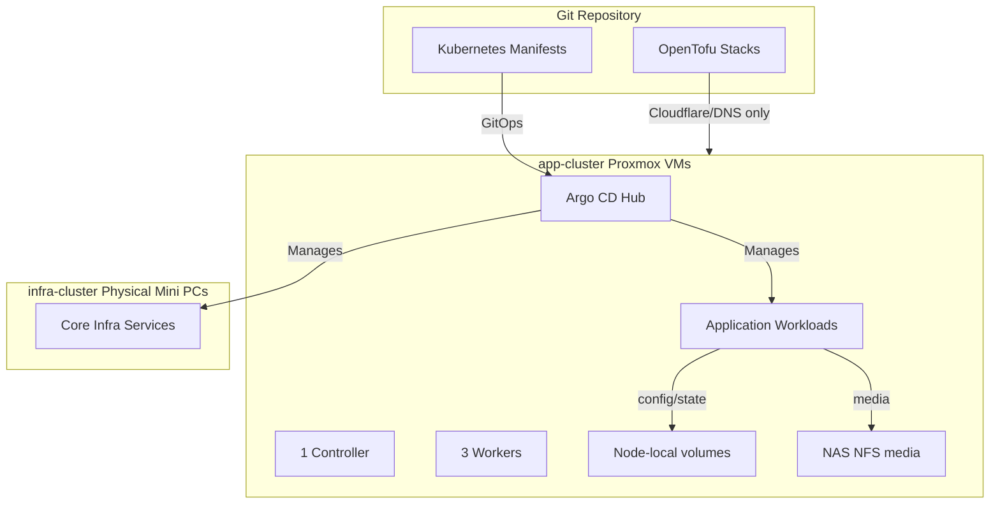

# 🏛️ Homelab Architecture Plan

## 🎯 Objective

Operate the Talos/Kubernetes homelab from this repository as the active deployment home for applications and infrastructure services.

## 🌱 Lineage & Origin

This codebase was originally bootstrapped from [ajaykumar4/cluster-template](https://github.com/ajaykumar4/cluster-template) and now operates two independent Talos clusters through one Argo CD hub.

## 🏗️ Active Structure

-   `app-cluster`: Primary application cluster running on Talos VMs: one controller (`k8s-ctrl-01`) and three workers (`k8s-wrkr-01-gpu`, `k8s-wrkr-02`, `k8s-wrkr-03`). The controller hosts control-plane components only; user workloads run on workers.
-   `infra-cluster`: Independent two-node physical Talos cluster (one control-plane mini PC, one worker mini PC) running core baseline services. It is unchanged by app-cluster work and remains managed by the app-cluster Argo CD hub.
-   `infra/terraform_cloudflare/`: Cloudflare tunnel, DNS, Access resources, and tunnel credentials.
-   `infra/terraform_localdns/`: Kubernetes local DNS OpenTofu stack.
-   `talos/`, `kubernetes/`, `bootstrap/`, and `.taskfiles/`: Talos, Argo CD, and Kubernetes workspace.
-   `kubernetes/apps/app-cluster/` & `kubernetes/apps/infra-cluster/`: Workload manifests separated by destination cluster.
-   `kubernetes/argo/apps/app-cluster/` & `kubernetes/argo/apps/infra-cluster/`: Argo CD Applications separated by destination cluster.
-   **Storage**: app-cluster config/state PVCs use the node-local `local-path` StorageClass (`ReadWriteOnce`, `Retain`) backed by dedicated worker user volumes. Permanent media/downloads use the static NAS NFS claim (`media-library-pvc`) at `10.0.40.2:/media`. No Ceph or Ceph CSI is deployed in the app cluster.
-   **Infrastructure ownership**: `home-dc-proxmox` configures the host with Ansible; `home-dc-terraform` provisions its guests with OpenTofu. This repository consumes those VMs and owns Talos, Kubernetes and GitOps.

## 🚧 Current Migration Direction

-   `home-dc-kubernetes` is the active source of truth for Kubernetes and GitOps.
-   Argo CD targets this repository.
-   The app-cluster is rebuilt as one controller and three workers on standalone Proxmox; the two-node physical `infra-cluster` is retained unchanged.
-   Ceph-backed storage is removed from the app cluster; config/state moves to node-local `local-path` volumes with off-node backups, and media remains on the existing NAS NFS export.
-   Former host-level Docker services are being retired or migrated into Kubernetes.

> **Supersedes:** [Argo Cluster Relocation](../archive/ARGO_CLUSTER_MIGRATION.md) (2026-03) and prior control-plane-only sizing decisions. The current steady state is one app-cluster controller plus three workers with local-path/NFS storage.

## 🤔 Assumptions

-   The app-cluster is rebuilt as one controller and three workers on Proxmox VMs with static IPs and MAC-bound NICs.
-   Proxmox host configuration is owned by `home-dc-proxmox` (Ansible); VM provisioning is owned by `home-dc-terraform` (OpenTofu). This repo consumes the resulting VMs.
-   The two-node physical `infra-cluster` remains unchanged and continues to be managed by the app-cluster Argo CD hub.
-   Secrets and runtime artifacts remain local-only and gitignored.
-   Doppler project names and existing external integrations can stay unchanged.
-   App-cluster storage uses node-local `local-path` volumes (`ReadWriteOnce`, `Retain`) for config/state and NAS NFS (`media-library-pvc`) for media/downloads; no Ceph cluster is available.
-   Stateful app data on local-path volumes requires tested off-node backups **before cutover**; restore is required after worker disk/host failure.
-   Splitting OpenTofu directories must preserve Kubernetes resource addresses so existing tunnels, DNS records, and Access apps are not recreated.

## ✅ Validation Checks

-   `task tf:init`
-   `task tf:plan`
-   `task tf:cloudflare:plan`
-   `task tf:localdns:plan`
-   `kubectl get nodes -o wide` shows one controller and three workers Ready
-   `talosctl --talosconfig talos/app/clusterconfig/talosconfig config info`
-   `task sync-argo-bootstrap`
-   `kubectl get storageclass local-path`
-   `kubectl get pvc -A` shows expected local-path and NFS claims
-   Worker user volumes mounted at `/var/mnt/local-path-provisioner` on each worker
-   Backup/restore smoke test completed for at least one stateful app before cutover

## ↩️ Rollback

**Pre-cutover** (before DNS/ingress points at the replacement app cluster):

-   Stop syncing to the replacement app cluster and keep the old cluster/routes available if still operational.
-   Restore from the last consistent off-node backup onto the new local volumes if the old cluster's storage is no longer usable.

**Post-cutover** (Argo CD already targets `home-dc-kubernetes`):

1.  Revert DNS/ingress to the old deployment only if its storage and data remain usable.
2.  Otherwise restore the latest verified backup onto the new local-path volumes and reapply the previous Git revision.
3.  Restore any copied local-only runtime files from backups if the workspace is discarded.
4.  Reintroduce or replace worker nodes by updating `talos/app/talconfig.yaml`, regenerating machine configs, and restoring data.
5.  A failed worker disk/host requires off-node backup restore; node-local volumes do not fail over to another worker automatically.
6.  The independent `infra-cluster` is never rolled back as part of app-cluster changes.
