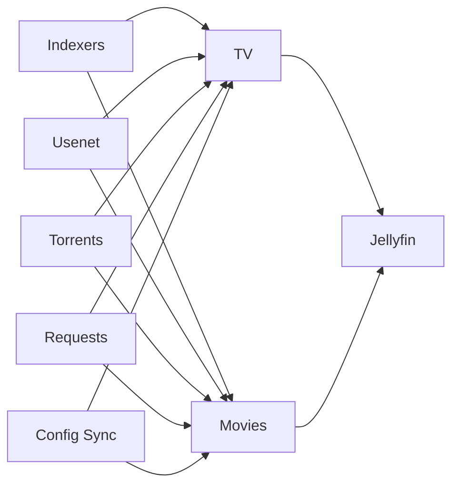

# 🎬 Media Management Stack

## 🎯 Objective

For the observed NAS paths and step-by-step app UI settings, use [the media app setup runbook](../plan/media-app-setup.md).

Add media-management services that feed Jellyfin while preserving the existing storage split:

-   `local-path` `ReadWriteOnce` for application-owned config and state
-   NFS for shared media library and download paths
-   small, reversible rollout starting with `sabnzbd` and `sonarr`

## 📌 Scope

Current rollout includes:

-   `sabnzbd`
-   `qbittorrent`
-   `sonarr`
-   `prowlarr`
-   `recyclarr`
-   `radarr`
-   `jellyseerr`

`tdarr` was removed; transcode/health-check duties will be handled by Jellyfin hardware transcoding on the GPU worker once the NVIDIA device plugin is available.

Deferred until the first apps are stable:

-   API-key automation between services

## 📌 Namespace Decision

-   Reuse the existing `media` namespace

Rationale:

-   these services ultimately exist to source content for Jellyfin
-   the namespace already contains the shared media-library claim and routing patterns
-   it avoids cross-namespace duplication for the first rollout

## 💾 Storage Model

-   Each app gets its own `local-path` `ReadWriteOnce` PVC for `/config`
-   Shared media content remains on the NFS export at `10.0.40.2:/media`
-   The existing `media-library-pvc` remains the shared claim for the full library mount
-   Download paths are mounted from the same NFS claim using subpaths under `/media/downloads`
-   Pods are pinned to a worker via `nodeSelector` so RWO volumes stay co-located with their consumers

Planned pod paths:

-   `sonarr`
    -   `/config` on local-path
    -   `/media` on NFS
    -   `/downloads` on NFS subpath `downloads/complete`
    -   `PATH` includes `/app/sonarr/bin` so the bundled `ffprobe` is available during completed-download sample detection
-   `sabnzbd`
    -   `/config` on local-path
    -   `/media` on NFS
    -   `/downloads` on NFS subpath `downloads/complete`
    -   `/incomplete-downloads` on NFS subpath `downloads/incomplete`
-   `qbittorrent`
    -   `/config` on local-path
    -   `/downloads` on NFS subpath `downloads/complete`
    -   `/incomplete-downloads` on NFS subpath `downloads/incomplete`
    -   peer traffic exposed through a dedicated `LoadBalancer` service on `6881/TCP` and `6881/UDP`
-   `prowlarr`
    -   `/config` on local-path
-   `recyclarr`
    -   `/config` on local-path
    -   reads API keys from Kubernetes secrets synced from Doppler
-   `radarr`
    -   `/config` on local-path
    -   `/media` on NFS
    -   `/downloads` on NFS subpath `downloads/complete`
-   `jellyseerr`
    -   `/app/config` on local-path
-   `jellyfin`
    -   `/config` and `/cache` on local-path
    -   `/data` on NFS
    -   `/transcode` on an in-memory `emptyDir`
    -   scheduled on `k8s-wrkr-01-gpu` with `runtimeClassName: nvidia` and `nvidia.com/gpu: "1"` once the device plugin is ready

## 📌 API-Key Automation Direction

The long-term goal is to automate cross-service integration, especially for Prowlarr, Sonarr, and Radarr.

For the initial rollout, do not assume app API keys can be cleanly injected through environment variables. Many of these applications generate and own their API keys internally.

Recyclarr is the first exception to that rule because it is an API client rather than an API server. It is a good fit for Doppler-backed secrets because it only needs to consume Sonarr and later Radarr API keys.

Recommended future pattern:

-   deploy apps first
-   add a bootstrap or reconciliation job that:
    -   waits for app readiness
    -   discovers or rotates API keys through supported APIs
    -   configures downstream integrations

This avoids coupling runtime app internals to guessed static secrets in Doppler.

## 📝 Security Notes

-   Public ingress is acceptable temporarily for test access, but each app still needs its own application authentication enabled in the UI
-   SABnzbd server credentials should not be committed; if later automated, source them from Doppler
-   qBittorrent WebUI password is sourced from Doppler (`home-dc-kubernetes/apps`, `QBITTORRENT_WEBUI_PASSWORD`). An init container derives qBittorrent's PBKDF2 setting on local-path storage before the app starts; the plaintext password is never written to Git or exposed to the main container.
-   qBittorrent peer efficiency depends on a manual router forward to the peer `LoadBalancer` IP and is not handled by Cloudflare
-   Recyclarr API credentials should be sourced from Doppler rather than committed into Git
-   The NFS-backed media library remains shared state and should be treated as retained data

## 🤔 Assumptions

-   `/media/downloads`
-   `/media/downloads/complete`
-   `/media/downloads/incomplete`

already exist or can be created on the NFS server before workloads start.

-   The local-path provisioner is installed and restricted to workers with dedicated data disks.
-   Jellyfin now schedules on the GPU worker; its `/health` response is `Healthy`, but actual hardware playback/transcoding still needs an end-to-end check.

## ✅ Validation

-   Argo sync succeeds for the deployed apps
-   Jellyfin may take up to ten minutes for FFmpeg capability validation. TCP liveness confirms Kestrel is running without interrupting that scan, while `/health` remains the readiness gate.
-   Jellyfin uses `Recreate` because its SQLite-backed configuration and node-pinned resource request cannot safely support concurrent old and new pods.
-   PVCs bind on `local-path` and remain on the scheduled worker
-   pods mount both local-path config and NFS library paths
-   `sabnzbd` serves its UI and can write test files under `/downloads`
-   `qbittorrent` serves its UI and can write test files under `/downloads` and `/incomplete-downloads`
-   `qbittorrent-secrets` is synced by the Doppler operator and the qBittorrent init container completes before the app starts
-   `sonarr` serves its UI and can see both `/media` and `/downloads`
-   `sonarr` can resolve `ffprobe` from the container `PATH`
-   `prowlarr` serves its UI and can reach Sonarr over the in-cluster service
-   `recyclarr` can run against Sonarr without authentication failures
-   `radarr` serves its UI and can see both `/media` and `/downloads`
-   `jellyseerr` serves its UI and can reach Jellyfin, Sonarr, and Radarr over the configured URLs
-   `jellyfin` serves its UI, can see `/data`, and reports `Healthy` at `/health`
-   GPU transcode is verified in Jellyfin logs once `nvidia.com/gpu` is available

## 📝 Container Image Pinning (2026-09-30)

The Jellyseerr, Prowlarr, and qBittorrent containers retain their upstream `latest` tags for Renovate discovery, while Kubernetes receives an explicit immutable digest. Renovate must update the digest through a reviewed PR; workloads do not silently change when an upstream tag moves.

This supersedes tag-only image resolution for these three workloads. The pinned digests were taken from their running pods and validated against rendered app-template manifests, including both qBittorrent containers.

Rollback by reverting the digest fields to restore tag-only resolution. Validate image updates by reviewing the digest and rendering the affected app-template release before merge.

## ↩️ Rollback

-   Remove Jellyfin's startup probe only after confirming its startup duration remains below the liveness budget; otherwise retain it to avoid restart loops.
-   Restoring Jellyfin `RollingUpdate` requires enough capacity for two 3GiB pods and a safe concurrent SQLite access model.
-   Delete the `sabnzbd`, `qbittorrent`, `sonarr`, `prowlarr`, `recyclarr`, `radarr`, `jellyseerr`, and `jellyfin` Argo applications
-   Remove their HTTPRoutes
-   Delete their local-path PVCs only if app config should be discarded; retain NFS media content
-   Remove the qBittorrent DopplerSecret and password init container; the existing config backup remains available for manual recovery
-   Retain NFS media content and download directories
