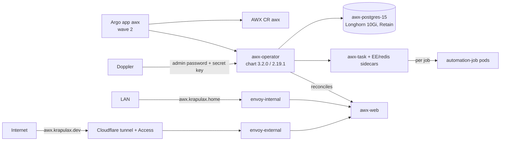

# AWX (app cluster, `dev` namespace)

**Decision date:** 2026-11-21. **Status:** proposed (PR).

## Goal

Run AWX (upstream Ansible Automation Controller) on the app cluster for playbook runs, inventory syncs (for example the planned AWX inventory sync from the PowerShell Universal account list) and scheduled automation. It lives in a new `dev` namespace for tooling workloads.

## Architecture

-   Argo app: `kubernetes/argo/apps/app-cluster/dev/awx.yaml`. It has two sources: the community `awx-operator` Helm chart, which installs the operator and CRDs, and `kubernetes/apps/app-cluster/dev/awx`, which holds the `AWX` CR, the `DopplerSecret` and the routes.
-   The chart has `AWX.enabled: false`. The instance is the plain manifest `config/awx.yaml`, synced in wave 1 inside the app with `SkipDryRunOnMissingResource=true`.
-   The chart's metrics-authentication sidecar uses `quay.io/brancz/kube-rbac-proxy:v0.15.0` via `operator-controller-containers`: the chart's default `gcr.io/kubebuilder/kube-rbac-proxy:v0.15.0` was unavailable. The proxy arguments and operator image remain unchanged.
-   Service: `awx-service:80` (ClusterIP, `ingress_type: none`). Exposure goes only through the Envoy HTTPRoutes.
-   Hostnames: `awx.krapulax.home` (internal, Technitium ExternalDNS) and `awx.krapulax.dev` (external, Cloudflare ExternalDNS through `external-apps.krapulax.dev` and the tunnel's `*.krapulax.dev` rule).
-   Storage: the operator-managed PostgreSQL 15 StatefulSet claims `longhorn` 10Gi. The StorageClass reclaim policy is `Retain`, and `postgres_keep_pvc_after_upgrade: true` is set. Projects are not persisted (`projects_persistence: false`); jobs pull them from Git.
-   Resources: requests come to about 0.4 CPU and 2 GiB, with limits of about 7 GiB. Each running job adds one automation-job pod.

## Design decisions

| Decision                                  | Reason                                                                                                                                                                           |
| ----------------------------------------- | -------------------------------------------------------------------------------------------------------------------------------------------------------------------------------- |
| awx-operator, not Docker Compose          | The operator is the only supported install path. Compose is development-only.                                                                                                    |
| Operator chart + plain CR                 | The CR is reviewed as a normal manifest. Chart upgrades (Renovate) do not touch the instance spec.                                                                               |
| Not app-template                          | AWX is a multi-component app reconciled by its operator, so the app-template pattern does not apply.                                                                             |
| Operator-generated Postgres configuration | Only two values need to be human-held. The DB password lives in `dev/awx-postgres-configuration`; it is captured with the DB backup follow-up.                                   |
| `AWX_SECRET_KEY` from Doppler             | Stored credentials are encrypted with it. Losing it makes any DB restore useless, so it must survive namespace loss.                                                             |
| External exposure (requested 2026-11-21)  | The user asked for internal and external DNS. AWX holds infrastructure credentials, so the public hostname must sit behind **Cloudflare Access (allowed emails)**, not `bypass`. |

## Assumptions

-   The chart `awx-operator` 3.2.0 exists at `https://ansible-community.github.io/awx-operator-helm/` with appVersion 2.19.1 (AWX 24.6.1). Upstream AWX has published no newer release since 2024.
-   The Quay proxy image remains available for the cluster's worker architecture and accepts the chart's v0.15.0 proxy arguments. Check image availability and startup when upgrading the chart.
-   The operator reads key `password` from `admin_password_secret` and key `secret_key` from `secret_key_secret`, so one Secret can serve both.
-   The `envoy-external` and `envoy-internal` listeners accept routes from the `dev` namespace, as they do for `trading`.
-   Longhorn ext4 volumes need `postgres_data_volume_init: true` so the Postgres UID (26) can own its data directory.

## AWX database backup design

AWX PostgreSQL is exported with a dedicated marked `backrest_backup` login, not a live PGDATA copy. `task backups:awx-credentials` uses the database pod's local PostgreSQL administrative connection to provision that login without rotating the AWX application user. It creates `AWX_BACKUP_PASSWORD` in Doppler if missing and copies the operator-generated `awx-postgres-configuration` password into `AWX_DB_PASSWORD` only if no conflicting value exists; never silently overwrite an existing recovery credential.

An app-cluster Backrest export CronJob runs the matching PostgreSQL 15 client and publishes a validated custom-format dump, role definitions and recovery metadata to the retained Backrest staging claim. Before publishing, it verifies that the captured application database password can authenticate. The archive also contains the operator-generated PostgreSQL password and the existing `AWX_SECRET_KEY`, which encrypts AWX credentials. The `app-awx-db` Backrest plan requires a fresh export and encrypts it in the existing NAS repository. Staging files contain secrets and remain private; logs and Git must never contain values.

Assumptions to validate: the operator-managed database is `dev/awx-postgres-15` using PostgreSQL 15, its application database/user are `awx`, and the PostgreSQL pod permits the local administrative connection. A generated password change requires a reviewed recovery-credential update before backups resume. After deployment, run an export and plan, restore the archive to a fresh isolated PostgreSQL 15 instance with outbound integrations disabled, verify data and AWX credential recovery, and record immutable snapshot and version evidence. A successful dump or archive extraction alone does not prove recovery.

Rollback: suspend or revert the CronJob and plan while retaining encrypted snapshots, repository keys, `AWX_SECRET_KEY` and the recovery credentials. Do not delete the database, rotate its application password, or drop an unverified role as rollback.

## Security impact

-   **Secrets**: Doppler `home-dc-kubernetes/apps` provides `AWX_ADMIN_PASSWORD` and `AWX_SECRET_KEY`, synced to `dev/awx-secrets`. The backup exporter receives `AWX_BACKUP_PASSWORD`, `AWX_DB_PASSWORD`, and `AWX_SECRET_KEY` in `backups/backrest-secrets`; recovery material is included only in private staging and encrypted snapshots. No secret is stored in Git.
-   **Access**: the internal route relies on the trusted LAN plus the AWX login. The external route must get a Cloudflare Access application (allowed emails) in `home-dc-terraform` **before** the manual `cloudflare-dns` sync publishes `awx.krapulax.dev`. Until then the name does not resolve publicly.
-   **Blast radius**: AWX can reach anything its stored credentials allow. Give machine credentials least privilege, and prefer per-environment credentials.
-   **Backups**: `app-protect` remains `protect: false` because a file copy of a running PGDATA is not valid; the separate native `app-awx-db` Backrest plan covers PostgreSQL. The initial export, backup and isolated restore must pass before claiming coverage.

## Validation

1.  `kubectl -n dev get awx awx` shows `Successful`. `kubectl -n dev get pods` shows web, task and postgres pods `Running`.
    Confirm the operator pod is `2/2` ready, including `kube-rbac-proxy`, and has no image-pull errors.
2.  `dig +short awx.krapulax.home` returns `kubernetes.krapulax.home` (`10.0.40.102`), and `http://awx.krapulax.home` shows the login page.
3.  Log in as `admin` with the Doppler password.
4.  After the Access application exists, sync `cloudflare-dns`. `https://awx.krapulax.dev` then shows the Cloudflare Access challenge first, then the AWX login.
5.  Run the Demo Job Template. The automation-job pod starts in `dev` and completes.

## Rollback

-   To revert only the proxy-image override, remove `operator-controller-containers` from the chart values and sync. The chart's GCR image was unavailable at the time of this change, so this rollback can leave the operator pod unready; use only after a working upstream image is available.
-   Delete `kubernetes/argo/apps/app-cluster/dev/awx.yaml` (or revert the PR). Argo prunes the operator, the CR and the routes. The operator removes web, task and Postgres. The Postgres PV is retained (`Retain`) for recovery.
-   To restore the same data later, keep `AWX_SECRET_KEY` unchanged in Doppler and re-bind the retained PV.
-   Remove the Cloudflare Access application and the public DNS record if the app is retired.

## Open questions

-   Should the public route stay once Cloudflare Access is in place, or should AWX be reached through Tailscale only?
-   Where should the Ansible content live (a new repository, or inside `home-dc-proxmox`), and which execution environment image should it use?

## Next actions

-   [ ] Create `AWX_ADMIN_PASSWORD` and `AWX_SECRET_KEY` in Doppler `home-dc-kubernetes/apps` before merging.
-   [ ] Merge, then confirm the Validation steps 1–3 above.
-   [ ] `home-dc-terraform`: add a Cloudflare Access application for `awx.krapulax.dev` (allowed emails), then sync `cloudflare-dns`.
-   [ ] Run the first `app-awx-db` native export and Backrest snapshot; rehearse recovery and record the evidence.
-   [ ] Add the `dev` group/icon check on Homepage after the annotation workflow runs on `main`.
