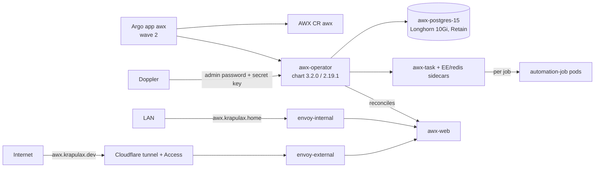

# AWX (app cluster, `dev` namespace)

**Decision date:** 2026-11-21. **Status:** proposed (PR).

## Goal

Run AWX (upstream Ansible Automation Controller) on the app cluster for playbook runs, inventory syncs (for example the planned AWX inventory sync from the PowerShell Universal account list) and scheduled automation. It lives in a new `dev` namespace for tooling workloads.

## Architecture

- Argo app: `kubernetes/argo/apps/app-cluster/dev/awx.yaml`. It has two sources: the community `awx-operator` Helm chart, which installs the operator and CRDs, and `kubernetes/apps/app-cluster/dev/awx`, which holds the `AWX` CR, the `DopplerSecret` and the routes.
- The chart has `AWX.enabled: false`. The instance is the plain manifest `config/awx.yaml`, synced in wave 1 inside the app with `SkipDryRunOnMissingResource=true`.
- Service: `awx-service:80` (ClusterIP, `ingress_type: none`). Exposure goes only through the Envoy HTTPRoutes.
- Hostnames: `awx.krapulax.home` (internal, Technitium ExternalDNS) and `awx.krapulax.dev` (external, Cloudflare ExternalDNS through `external-apps.krapulax.dev` and the tunnel's `*.krapulax.dev` rule).
- Storage: the operator-managed PostgreSQL 15 StatefulSet claims `longhorn` 10Gi. The StorageClass reclaim policy is `Retain`, and `postgres_keep_pvc_after_upgrade: true` is set. Projects are not persisted (`projects_persistence: false`); jobs pull them from Git.
- Resources: requests come to about 0.4 CPU and 2 GiB, with limits of about 7 GiB. Each running job adds one automation-job pod.

## Design decisions

| Decision                                  | Reason                                                                                                                                                                           |
| ----------------------------------------- | -------------------------------------------------------------------------------------------------------------------------------------------------------------------------------- |
| awx-operator, not Docker Compose          | The operator is the only supported install path. Compose is development-only.                                                                                                    |
| Operator chart + plain CR                 | The CR is reviewed as a normal manifest. Chart upgrades (Renovate) do not touch the instance spec.                                                                               |
| Not app-template                          | AWX is a multi-component app reconciled by its operator, so the app-template pattern does not apply.                                                                             |
| Operator-generated Postgres configuration | Only two values need to be human-held. The DB password lives in `dev/awx-postgres-configuration`; it is captured with the DB backup follow-up.                                   |
| `AWX_SECRET_KEY` from Doppler             | Stored credentials are encrypted with it. Losing it makes any DB restore useless, so it must survive namespace loss.                                                             |
| External exposure (requested 2026-11-21)  | The user asked for internal and external DNS. AWX holds infrastructure credentials, so the public hostname must sit behind **Cloudflare Access (allowed emails)**, not `bypass`. |

## Assumptions

- The chart `awx-operator` 3.2.0 exists at `https://ansible-community.github.io/awx-operator-helm/` with appVersion 2.19.1 (AWX 24.6.1). Upstream AWX has published no newer release since 2024.
- The operator reads key `password` from `admin_password_secret` and key `secret_key` from `secret_key_secret`, so one Secret can serve both.
- The `envoy-external` and `envoy-internal` listeners accept routes from the `dev` namespace, as they do for `trading`.
- Longhorn ext4 volumes need `postgres_data_volume_init: true` so the Postgres UID (26) can own its data directory.

## Security impact

- **Secrets**: Doppler `home-dc-kubernetes/apps` provides `AWX_ADMIN_PASSWORD` and `AWX_SECRET_KEY`, synced to `dev/awx-secrets`. No secret is stored in Git.
- **Access**: the internal route relies on the trusted LAN plus the AWX login. The external route must get a Cloudflare Access application (allowed emails) in `home-dc-terraform` **before** the manual `cloudflare-dns` sync publishes `awx.krapulax.dev`. Until then the name does not resolve publicly.
- **Blast radius**: AWX can reach anything its stored credentials allow. Give machine credentials least privilege, and prefer per-environment credentials.
- **Backups**: none yet. `app-protect` has `protect: false` (a file copy of a running PGDATA is not a valid backup). A native `pg_dump` export with a Backrest plan, following the immich-db pattern, is tracked in #637.

## Validation

1.  `kubectl -n dev get awx awx` shows `Successful`. `kubectl -n dev get pods` shows web, task and postgres pods `Running`.
2.  `dig +short awx.krapulax.home` returns `kubernetes.krapulax.home` (`10.0.40.102`), and `http://awx.krapulax.home` shows the login page.
3.  Log in as `admin` with the Doppler password.
4.  After the Access application exists, sync `cloudflare-dns`. `https://awx.krapulax.dev` then shows the Cloudflare Access challenge first, then the AWX login.
5.  Run the Demo Job Template. The automation-job pod starts in `dev` and completes.

## Rollback

- Delete `kubernetes/argo/apps/app-cluster/dev/awx.yaml` (or revert the PR). Argo prunes the operator, the CR and the routes. The operator removes web, task and Postgres. The Postgres PV is retained (`Retain`) for recovery.
- To restore the same data later, keep `AWX_SECRET_KEY` unchanged in Doppler and re-bind the retained PV.
- Remove the Cloudflare Access application and the public DNS record if the app is retired.

## Open questions

- Should the public route stay once Cloudflare Access is in place, or should AWX be reached through Tailscale only?
- Where should the Ansible content live (a new repository, or inside `home-dc-proxmox`), and which execution environment image should it use?

## Next actions

- [ ] Create `AWX_ADMIN_PASSWORD` and `AWX_SECRET_KEY` in Doppler `home-dc-kubernetes/apps` before merging.
- [ ] Merge, then confirm the Validation steps 1–3 above.
- [ ] `home-dc-terraform`: add a Cloudflare Access application for `awx.krapulax.dev` (allowed emails), then sync `cloudflare-dns`.
- [ ] Add a native `pg_dump` export with an `app-awx-db` Backrest plan, and flip the app-protect entry off `protect: false`.
- [ ] Add the `dev` group/icon check on Homepage after the annotation workflow runs on `main`.
