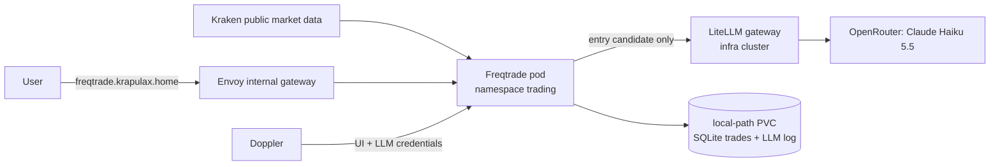

# Freqtrade crypto trading bot (app cluster)

**Decision date:** 2026-11-04. **Status:** dry-run (paper trading) only.

## Goal

Run an automated crypto spot-trading bot as a learning experiment, with an LLM (Claude Haiku via the shared LiteLLM gateway) acting as an extra **veto** on entries. Phase 1 trades simulated money only. Real money is a separate, explicit change (see [the rollout plan](../plan/freqtrade-rollout.md)).

This is not expected to be profitable. The success measure is whether the bot beats simply holding BTC over the same period, after fees.

## Architecture

-   Namespace: `trading` (new). Argo app: `kubernetes/argo/apps/app-cluster/trading/freqtrade.yaml`.
-   Runtime: bjw-s `app-template` 5.3.0, image `freqtradeorg/freqtrade:2026.10`.
-   Exchange: **Kraken spot**, GBP pairs (`BTC/GBP`, `ETH/GBP`, `SOL/GBP`). Kraken is FCA-registered and officially supported by Freqtrade; Coinbase is not on Freqtrade's supported list.
-   Strategy: `LlmTrendStrategy` (ConfigMap, mounted at `/freqtrade/strategies`).
    -   4h candles. Entry when EMA21 crosses above EMA55, price above EMA200, RSI below 70.
    -   Exit on the reverse EMA cross, an 8% stop-loss, or a 3% trailing stop once 5% in profit.
    -   Protections: cooldown after each exit, `StoplossGuard`, and `MaxDrawdown` (pauses all trading for 2 days at 15% drawdown).
    -   **LLM veto**: before any dry-run/live entry, the strategy sends 60 daily candles (numbers only, no news or free text) to the model and enters only on a `risk_on` verdict. Verdicts are cached per pair for 12 hours and appended to `/freqtrade/user_data/llm_decisions.jsonl`.
-   Account: `dry_run: true`, simulated wallet of £500, at most 3 open trades, long-only spot, no leverage, no futures.
-   UI: FreqUI (bundled in the image) on the internal gateway only: `http://freqtrade.krapulax.home`. No external route, no Cloudflare tunnel.
-   Placement: pinned to `k8s-wrkr-01-gpu`, the least-loaded worker ([workload placement](workload-placement.md)); the PVC is node-local.

## Design decisions

| Decision                    | Reason                                                                                                                                                    |
| --------------------------- | --------------------------------------------------------------------------------------------------------------------------------------------------------- |
| Freqtrade, not an LLM agent | Mature, backtestable, deterministic order handling and risk controls. The LLM cannot place orders, size trades or change stops.                           |
| LLM can only veto           | The worst a bad or failed LLM answer can do is skip a trade. Any error, timeout, missing key or unparseable reply is treated as "no entry" (fail closed). |
| LLM via LiteLLM, not direct | Reuses the shared gateway. A dedicated LiteLLM virtual key carries a hard spend budget and is limited to one model.                                       |
| No exchange keys in phase 1 | Dry-run only needs public market data. No credential exists that could move money.                                                                        |
| Internal UI only            | The API can force trades. Keep it off the internet; exposure would need Cloudflare Access in `home-dc-terraform` first.                                   |
| GBP pairs                   | Avoids FX conversion on deposits and on every trade.                                                                                                      |
| 4h timeframe, max 3 trades  | Fewer trades means less fee drag on a small balance. Kraken only returns 720 candles per request; 720 × 4h covers 120 days, enough for EMA200 warm-up.    |

## Assumptions

-   `litellm.krapulax.home` does not resolve from app-cluster pods (NXDOMAIN, checked 2026-11-04), so the bot uses the tunnel URL `https://litellm.krapulax.dev/v1`. Cloudflare blocks Python's default User-Agent (error 1010), so the strategy sends its own. If the infra-internal name is made resolvable from the app cluster, the internal URL can be used instead.
-   OpenRouter serves `anthropic/claude-haiku-5.5` (checked 2026-11-04); LiteLLM exposes it as `openrouter/claude-haiku-5.5`.
-   Kraken's public API is reachable from the cluster without authentication.
-   LLM backtests are not possible: `confirm_trade_entry` only runs in dry-run/live. Backtests measure the technical baseline only.

## Security impact

-   **Secrets** (Doppler `home-dc-kubernetes/apps` → `trading/freqtrade-secrets`): FreqUI password, JWT secret, websocket token and the LiteLLM virtual key. No exchange keys in phase 1.
-   **Network**: outbound to Kraken and LiteLLM only (not enforced by a NetworkPolicy, matching other apps). Inbound only through the internal Envoy gateway.
-   **Pod**: runs as the image's non-root `ftuser` (UID 1000), no privilege escalation, all capabilities dropped, no service account token.
-   **Phase 2 (live) requirements**: a Kraken API key with _query + trade_ permission only, **no withdrawal permission**, IP-restricted to the home WAN address; a capped deposit; and a reviewed PR flipping `dry_run`.

## Backups

The data volume `freqtrade-data` (Longhorn, 3 replicas, 2 Gi) holds the trade database (SQLite) and the LLM decision log, so the pod is not tied to a node. Longhorn is not a backup: the volume is enrolled in `app-protect` (export 01:40 UTC, scheduled on the node where the pod runs) and Backrest (`app-freqtrade`, 03:10 UTC). The `app-protect` snapshot runs `PRAGMA integrity_check` on every copied SQLite file and fails closed, so a copy taken mid-write is rejected rather than stored. Downloaded market data, logs and backtest output are excluded; they can be re-downloaded. The volume was migrated from `local-path` on 2026-11-09; see [local-path to Longhorn](../operations/local-path-to-longhorn.md).

## Validation

1. `kustomize build kubernetes/apps/app-cluster/trading/freqtrade` and `helm template` with the values render cleanly.
2. After sync: the Argo app is `Synced/Healthy` and the pod is `Ready` (`/api/v1/ping`).
3. Logs show `Dry run is enabled`, Kraken markets loaded, and the strategy `LlmTrendStrategy` loaded.
4. FreqUI login works at `http://freqtrade.krapulax.home`.
5. From the pod, LiteLLM answers: `kubectl -n trading exec deploy/freqtrade -- python -c "import urllib.request;r=urllib.request.Request('https://litellm.krapulax.dev/health/liveliness',headers={'User-Agent':'freqtrade-llm-veto/1.0'});print(urllib.request.urlopen(r).status)"`.
6. The first entry signal writes a line to `llm_decisions.jsonl` with `"ok": true`.

## Rollback

Delete `kubernetes/argo/apps/app-cluster/trading/freqtrade.yaml` (or revert the commit). Argo prunes the workload. The `freqtrade-data` claim is annotated `Prune=false` and its volume is `Retain`, so the data stays until deleted deliberately. To return the bot to `local-path` after the Longhorn cutover, follow the order in the migration runbook's Rollback section (claim the old volume first); a plain revert would start the bot on an empty database. No real funds are involved in phase 1, so there are no open positions to unwind.
