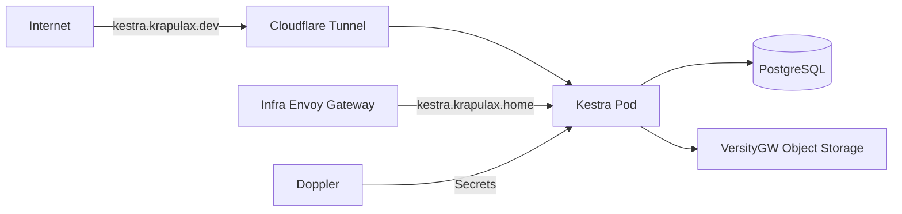

# ⚙️ Kestra Infra Deployment

**Historical deployment; retirement approved.** This document preserves the former
design for rollback, not an instruction to deploy Kestra. Active manifests and
routes are removed; follow [NAS target and infra retirement](nas-backup-target.md#kestra--kubevirt-retirement)
for the ordered live cleanup that retains its data.

Deploy Kestra on the infra cluster as the homelab automation service. It should stay available when the Proxmox-hosted app cluster is offline for maintenance.

## 🏛️ Architecture

-   Namespace: `kestra`
-   Runtime: upstream regular `kestra` Helm chart.
-   Database: dedicated PostgreSQL Helm release in the same namespace.
-   Object storage: in-cluster `versitygw` service backed by local-path storage.
-   Storage bootstrap: infra local-path provisioner creates retained local PVs for Kestra support services.
-   Placement: Kestra, PostgreSQL, VersityGW, and local-path helper pods are pinned to `infra-cp-01`.
-   Networking: internal HTTPRoute exposes Kestra through the infra Envoy gateway at `10.0.40.106`; public DNS points `kestra.krapulax.dev` at `external-infra.krapulax.dev`, and the infra Cloudflare Tunnel routes that hostname directly to the Kestra service.

## 📌 Security

-   Kestra basic auth, PostgreSQL credentials, and object-store credentials are synced from Doppler (`home-dc-kubernetes/infra`).
-   No secrets are committed to Git.
-   External access is gated by Cloudflare Access before Kestra basic auth.
-   Local storage is intentionally infra-cluster scoped; it should not be scheduled onto the app cluster.
-   Kestra is intended to orchestrate clean Proxmox, Ceph, VM, Kubernetes, and cluster stop/start workflows.

## 🛠️ Full-cluster maintenance workflow

The `home-kestra` repository owns the `homelab.ops` flow definitions. The maintenance flow runs on the physical infra cluster so it remains available while the Proxmox-hosted app cluster is down. It defaults to an inspection-only run. A live run requires an exact outage confirmation plus backup and external Ceph-client acknowledgements; it must never be scheduled.

Order: inventory and package simulation on all three Proxmox hosts; download reviewed packages; disable guest autostart and gracefully stop every running QEMU/LXC guest; verify no guests or known Ceph clients remain; stop Ceph MDS, OSD, manager, and monitor instances; install pinned package versions; reboot Proxmox hosts one at a time with quorum checks; restore Ceph monitor quorum and health; start previously running service guests before app-cluster VMs; restore each guest's original autostart setting and host timers. Kestra and its secrets remain on infra-cluster local storage.

Assumptions: the three target hosts are `pve-0` through `pve-2`; Proxmox HA is absent; all Ceph daemons and guests are discoverable through those hosts; package updates remain within the current Debian, PVE, and Ceph major versions; an operator has verified backups and any Ceph clients outside those hosts. The flow refuses unsupported layouts rather than guessing. It does not update Talos, the infra-cluster nodes, or application images. Those require separate procedures.

Validation: review the inspection artifact and preflight refusal reasons; validate the Kestra flow and namespace files; confirm the flow is unscheduled and starts in inspection mode. After an authorized live run, check Proxmox quorum, Ceph `HEALTH_OK`, original guest power and autostart states, app-cluster node readiness, ready service endpoints, and route behavior. Guest `running` alone does not prove Kubernetes recovery.

Rollback: maintenance records original state on all three hosts. If a step fails, stop and follow the `home-kestra` recovery runbook; do not run the legacy shutdown/startup flows over an incomplete maintenance operation. Package downgrades are not automatic; restore from host backups if a package upgrade itself must be reverted. Retained storage is never deleted by the flow.

## 🤔 Assumptions

-   `infra-cp-01` is the preferred node for critical automation because it should remain online while app-cluster VMs are restarted.
-   Argo CD on `app-cluster` may continue syncing this app initially, but the runtime should not depend on app-cluster nodes after sync.
-   `kestra.krapulax.home` should resolve directly to the infra-cluster internal Envoy gateway, not the app-cluster gateway.

## ✅ Validation

1. `kubectl kustomize kubernetes/apps/infra-cluster/automation/kestra-infra`
2. `kubectl kustomize kubernetes/apps/infra-cluster/storage/local-path-provisioner-infra`
3. Confirm Argo sync for `kestra-infra` and `local-path-provisioner-infra`.
4. Check `kubectl -n kestra get pods,pvc,httproute`.
5. Confirm Kestra pods are scheduled on `infra-cp-01`.
6. `dig +short kestra.krapulax.home` should return `10.0.40.106`.
7. `dig +short kestra.krapulax.dev CNAME` should return `external-infra.krapulax.dev`.
8. `curl -I https://kestra.krapulax.dev` should reach Kestra through Cloudflare Tunnel.
9. Open the internal Kestra route and verify login.

## ↩️ Rollback

1. Revert the PR or delete the `kestra-infra` Argo Application.
2. Argo prunes the chart resources and repo-managed manifests.
3. Retained local-path data remains on disk; remove it manually only after confirming no rollback is needed.
4. Recreate the Argo Application from Git to restore the deployment from the retained data.
