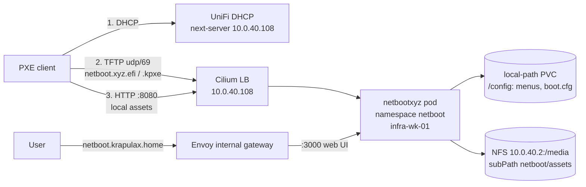

# netboot.xyz PXE boot server (infra cluster)

**Decision date:** 2026-11-06. **Status:** proposed.

## Goal

Network-boot machines on the home network (new Talos nodes, Proxmox hosts, rescue tools, OS installers) from a self-hosted [netboot.xyz](https://netboot.xyz) instance, with frequently used ISOs mirrored locally so they boot at LAN speed.

## Architecture

-   Namespace: `netboot` (new). Argo app: `kubernetes/argo/apps/infra-cluster/netboot/netbootxyz.yaml`.
-   Runtime: bjw-s `app-template` 5.3.0, image `ghcr.io/netbootxyz/netbootxyz:0.7.6-nbxyz4` (dnsmasq TFTP, nginx, Node.js web app).
-   Boot endpoint: `LoadBalancer` service `netbootxyz-boot` on `10.0.40.108` (Cilium LB IPAM + L2 announcement): `69/udp` TFTP, `8080/tcp` assets (nginx).
-   Web UI: `http://netboot.krapulax.home` (internal gateway only).
-   Storage: `/config` on a 1 GiB `local-path` PVC (backed up); `/assets` on the NAS media export (`netboot/assets` subfolder).
-   Placement: infra cluster, pinned to the worker `infra-wk-01` (`10.0.40.32`). The `local-path` config volume lives on that node.
-   DHCP: stays on the UniFi gateway. netboot.xyz does not ship a DHCP server.

## Design decisions

| Decision                            | Reason                                                                                                                                                                                                                                                                         |
| ----------------------------------- | ------------------------------------------------------------------------------------------------------------------------------------------------------------------------------------------------------------------------------------------------------------------------------ |
| LoadBalancer + `--tftp-single-port` | Standard TFTP replies from a new random port, which kube-proxy/Cilium do not reverse-NAT, so clients see the wrong source and time out. Single-port mode keeps the whole transfer on port 69, so it stays one flow. No `hostNetwork`, no privileged namespace, and a fixed IP. |
| Not `hostNetwork`                   | Would bind 69/80/3000 on the node itself, need a `privileged` PodSecurity namespace, and tie `next-server` to a node IP. Kept as the fallback (see Rollback).                                                                                                                  |
| Assets on NFS, not `local-path`     | ISOs are large and re-downloadable (like media). Keeps worker disks small and lets ISOs be copied straight onto the NAS share from a workstation.                                                                                                                              |
| Config on `local-path`, backed up   | Custom menus and `boot.cfg` edits are hand-made state. Small enough for `app-protect` + Backrest.                                                                                                                                                                              |
| Web UI internal only                | The UI has no authentication and can rewrite every boot menu. A malicious menu could install anything on a machine that network-boots.                                                                                                                                         |
| DHCP stays on UniFi                 | One DHCP authority per VLAN. A second DHCP server in the cluster would race the gateway.                                                                                                                                                                                       |
| Infra cluster, not app cluster      | PXE is core infrastructure, like DNS. On the infra cluster it can rebuild app-cluster nodes and Proxmox hosts, and an app-cluster outage does not take it down. It still cannot rebuild the infra cluster itself (chicken and egg); keep the Talos ISO/USB for that.           |

## Assumptions

-   `10.0.40.108` is free and outside the UniFi DHCP range for VLAN 40. It is inside the infra-cluster Cilium pool `infra-services` (`10.0.40.104/29`, usable `.105`–`.110`; `.105`–`.107` already used). The app-cluster pool covers the whole /24 and could also hand out `.108` to an unannotated LB service there; that overlap already exists for `.105`–`.107`.
-   PXE clients are on VLAN 40, or on a VLAN that UniFi routes and firewalls to `10.0.40.108` for `udp/69` and `tcp/8080`.
-   The NAS export `10.0.40.2:/media` allows root writes (other apps run with `PUID=0`), so kubelet can create `netboot/assets`.
-   Cilium reverse-NATs single-port TFTP replies on the LB IP with `externalTrafficPolicy: Cluster`. This is the case the upstream single-port change was tested for in Kubernetes ([docker-netbootxyz#55](https://github.com/netbootxyz/docker-netbootxyz/pull/55)).
-   Client firmware accepts TFTP data from port 69 (most do; this is not strictly RFC 1350).

## Security impact

-   **Secrets:** none. `docs/secrets-and-env-vars.md` is unchanged.
-   **Network:** `udp/69` and `tcp/8080` on `10.0.40.108` are reachable by anything on VLAN 40 (read-only TFTP/HTTP of boot files). Web UI only via the internal gateway. No Cloudflare/external route.
-   **Pod:** runs as root inside the container (image requirement; supervisord drops dnsmasq/nginx to `nbxyz`). Baseline PodSecurity, no `hostNetwork`, no service account token.
-   **Boot chain trust:** anyone who can edit menus controls what network-booted machines run. Keep the UI internal; consider Secure Boot binaries (`IPXE_SB_VERSION`) later.
-   **Backups:** `/config` via `app-protect` → Backrest plan `app-netbootxyz`. Assets are not backed up (re-downloadable).

## Validation

1. `kubectl --context infra-cluster -n netboot get pods,svc,pvc`: pod Ready, `netbootxyz-boot` has `EXTERNAL-IP 10.0.40.108`, both PVCs Bound.
2. From a workstation on VLAN 40: `tftp 10.0.40.108 -c get netboot.xyz.efi` (or `curl -o /dev/null tftp://10.0.40.108/netboot.xyz.efi`) downloads about 1 MB.
3. `curl -I http://10.0.40.108:8080/` returns 200 (nginx asset index).
4. `http://netboot.krapulax.home` opens the web UI.
5. A Proxmox VM on VLAN 40 set to network boot (OVMF and SeaBIOS) reaches the netboot.xyz menu.

## Rollback

-   Remove the UniFi network-boot settings first (clients fall back to local disk).
-   Revert the commit; Argo prunes the app. The NFS PV is `Retain`, so ISOs under `/media/netboot/assets` stay on the NAS; delete them by hand if unwanted. Restore `/config` from Backrest if redeploying.
-   If single-port TFTP fails through the LB: switch to `hostNetwork: true` (drop the `boot` service, label namespace `netboot` with `pod-security.kubernetes.io/enforce: privileged`, set `NGINX_PORT` to a free port such as `8080`) and point `next-server` at the node IP `10.0.40.32` (`infra-wk-01`).
