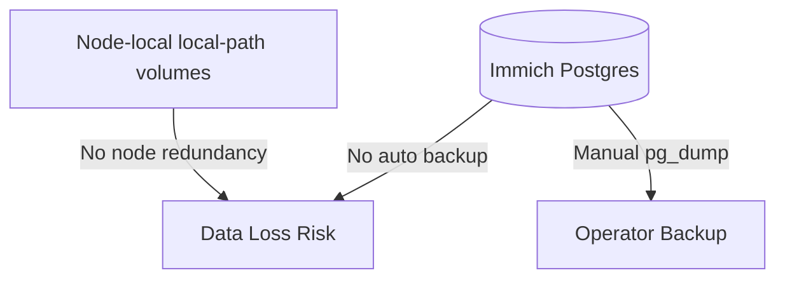

# 💾 Database Backups

This document tracks the backup strategy for databases and stateful app data in the app cluster.

## NAS target

The dedicated `10.0.40.2:/k8s-backup` export is the on-site target. Each cluster's
GitOps `nas-backup` Application provisions `backups/k8s-backup`, backed by a
static retained NFS PV. No S3 server is needed. Run `task backups:smoke
CLUSTER=app-cluster` or `task backups:smoke CLUSTER=infra-cluster` after Argo sync;
the probe verifies an encrypted backup, full data check and byte-identical restore.
See [design, permissions and rollout](../architecture/nas-backup-target.md).

**This is not a scheduled application backup or an offsite copy.** The inventory
and risks below remain until application-specific backup/restore jobs are deployed.
Use `app-cluster/<app>` and `infra-cluster/<app>` repository paths, with durable
repository passwords stored outside the clusters as well as in the secret manager.

## 📌 Current State

### 🗄️ Database / Stateful Inventory

| App    | Namespace | Data / PVC           | Storage class | Backup Strategy                           |
| ------ | --------- | -------------------- | ------------- | ----------------------------------------- |
| Immich | media     | immich-database-data | local-path    | None currently; manual `pg_dump` possible |

### 💾 Storage Context

-   App config and database PVCs use the node-local `local-path` StorageClass (`ReadWriteOnce`, `Retain`).
-   `Retain` only preserves the PV object when a PVC is deleted; it does **not** protect against worker disk failure, host corruption, or accidental PV deletion.
-   Node-local volumes are bound to the worker that first consumed them. A pod rescheduled to another worker cannot mount the original volume.
-   The NAS NFS media claim (`media-library-pvc`) is for media/downloads only, not for database or config state.

## 🚑 Operational Backup Gates

Before any of the following operations, take an application-consistent backup and verify a restore to a fresh local-path volume:

1.  **Worker disk/host replacement** — RWO volumes do not survive; restore is mandatory.
2.  **Major app image or schema update** — rollback may require restoring the previous database.
3.  **Cluster reset or Talos upgrade** — etcd and local-path data must be recoverable.
4.  **Cutover to a rebuilt app cluster** — export from the old cluster and import into the new local-path volumes before DNS switches.

## 🔄 Recovery

Recovery steps are application-specific, but the general pattern for local-path volumes is:

1.  Ensure the replacement PVC is created and bound on the target worker.
2.  Restore the backup into the running app container or database pod.
3.  Verify ownership/permissions and application consistency before exposing the service.
4.  For a complete worker rebuild, restore all affected app backups onto the new worker's user volume.

For application-level troubleshooting, see [Troubleshooting](/docs/operations/troubleshooting.md).

## 📝 Next Steps

-   Define an automated backup schedule (e.g., `volsync`, Kasten K10, Velero, or cron-based `pg_dump`) that copies local-path data to the NAS or another off-node target.
-   Document per-application restore runbooks and test them at least once per quarter.
-   Define RPO/RTO tiers for critical services.
