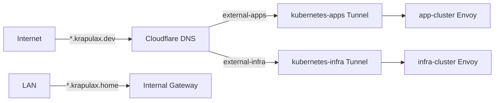

# ⚙️ Domain Configuration

Centralized documentation for external and internal DNS hostnames in the cluster.

## 🌐 Base Domains



| Domain                        | Target                    | Description                                          |
| ----------------------------- | ------------------------- | ---------------------------------------------------- |
| `krapulax.dev`                | -                         | Primary domain                                       |
| `external-apps.krapulax.dev`  | `kubernetes-apps` tunnel  | New canonical public endpoint for app-cluster routes |
| `external-infra.krapulax.dev` | `kubernetes-infra` tunnel | Canonical public endpoint for infra-cluster services |
| `internal.krapulax.dev`       | -                         | Internal routing                                     |
| `krapulax.home`               | `10.0.40.53`              | Internal zone served by Technitium                   |
| `kubernetes.krapulax.home`    | `10.0.40.102`             | Internal gateway target                              |

## 🚚 External endpoint migration

The target architecture contains only two public cluster endpoints:

-   app-cluster services use `external-apps.krapulax.dev`;
-   infra-cluster services use `external-infra.krapulax.dev`.

The migration from `external.krapulax.dev` is complete:

1. app-cluster routes target `external-apps.krapulax.dev`;
2. infra-cluster public records target `external-infra.krapulax.dev`;
3. `external.krapulax.dev` is not published as a Cloudflare DNS record.
4. service records do not point directly at `*.cfargotunnel.com` tunnel IDs.

## 📦 Application Hostnames

### 🔹 Argo CD

-   **URL:** `https://argo.krapulax.dev`
-   **Config:** `kubernetes/apps/app-cluster/argo-system/argo-cd/config/http-route.yaml`

### 🎬 Media

| App            | Hostname                      | Config                                                                    |
| -------------- | ----------------------------- | ------------------------------------------------------------------------- |
| Jellyfin       | `jelly.krapulax.dev`          | `kubernetes/apps/app-cluster/media/jellyfin/config/http-route.yaml`       |
| SABnzbd        | `sabnzbd.krapulax.dev`        | `kubernetes/apps/app-cluster/media/sabnzbd/config/http-route.yaml`        |
| qBittorrent    | `qbittorrent.krapulax.dev`    | `kubernetes/apps/app-cluster/media/qbittorrent/config/http-route.yaml`    |
| Sonarr         | `sonarr.krapulax.dev`         | `kubernetes/apps/app-cluster/media/sonarr/config/http-route.yaml`         |
| Radarr         | `radarr.krapulax.dev`         | `kubernetes/apps/app-cluster/media/radarr/config/http-route.yaml`         |
| Prowlarr       | `prowlarr.krapulax.dev`       | `kubernetes/apps/app-cluster/media/prowlarr/config/http-route.yaml`       |
| Jellyseerr     | `requests.krapulax.dev`       | `kubernetes/apps/app-cluster/media/jellyseerr/config/http-route.yaml`     |
| Immich         | `photos.krapulax.dev`         | `kubernetes/apps/app-cluster/media/immich/config/http-route.yaml`         |
| Chaptarr       | `chaptarr.krapulax.dev`       | `kubernetes/apps/app-cluster/media/chaptarr/config/http-route.yaml`       |
| Audiobookshelf | `audiobookshelf.krapulax.dev` | `kubernetes/apps/app-cluster/media/audiobookshelf/config/http-route.yaml` |

### 📊 Monitoring

| App         | Hostname              | Cluster | Config                                                                                                                                                                                                                                               |
| ----------- | --------------------- | ------- | ---------------------------------------------------------------------------------------------------------------------------------------------------------------------------------------------------------------------------------------------------- |
| Pulse       | `pulse.krapulax.dev`  | infra   | `kubernetes/apps/infra-cluster/monitoring/pulse-infra/config/http-route.yaml`                                                                                                                                                                        |
| Technitium  | `dns.krapulax.dev`    | infra   | `kubernetes/apps/infra-cluster/network/technitium-infra/config/http-route.yaml`, `kubernetes/apps/app-cluster/network/cloudflare-tunnel/config/dnsendpoint.yaml`, `kubernetes/apps/infra-cluster/network/cloudflare-tunnel-infra/config/config.yaml` |
| Uptime Kuma | `uptime.krapulax.dev` | infra   | `kubernetes/apps/infra-cluster/monitoring/uptime-kuma-infra/config/http-route.yaml`                                                                                                                                                                  |

### Retired automation

Kestra's public DNS declaration, tunnel origin and internal route have been
removed from desired configuration. Existing public DNS may remain while
`cloudflare-dns` is manually gated; do not force-sync it to clean up this record.
There is no public route for the NAS backup target.

### 🔹 Web

| App      | Hostname                | Config                                                            |
| -------- | ----------------------- | ----------------------------------------------------------------- |
| Homepage | `homepage.krapulax.dev` | `kubernetes/apps/app-cluster/web/homepage/config/http-route.yaml` |
| Echo     | `echo.krapulax.dev`     | `kubernetes/apps/app-cluster/default/echo/values.sops.yaml`       |

## Changing a domain

The zones live in one file, [`domains.yaml`](../../domains.yaml):

```yaml
public: [krapulax.dev] # Cloudflare, envoy-external; first entry is primary
internal: [krapulax.home] # Technitium, envoy-internal
```

### Design

-   **Assumption:** Argo CD has no variable substitution (no equivalent of Flux `postBuild.substitute`), and the Homepage and AutoKuma workflows read raw files on `main`. So manifests keep **literal** hostnames, and `scripts/domains.py` keeps them consistent with `domains.yaml`. What Git holds is exactly what Argo applies.
-   `scripts/domains.py check` (in `scripts/validate.sh`, so CI) fails when an `HTTPRoute` hostname or `external-dns` hostname is outside the listed zones, or a route on `envoy-external`/`envoy-internal` uses the other kind of zone.
-   `scripts/domains.py rename KIND OLD NEW` rewrites the zone in every tracked text file, including `*.sops.yaml` plaintext (all use `mac_only_encrypted`, so the MAC stays valid) and Helm values such as the Grafana `root_url`, the SABnzbd whitelist, the ExternalDNS zone/`domainFilters` and the CoreDNS forward zone. It skips:
    -   the label/annotation keys under `preserve` (`backup.krapulax.home/protect`, `monitoring.krapulax.home/target`, …), because renaming them would change selectors on live objects;
    -   the historical records under `rename_exclude` (`docs/archive/`, dated `docs/operations/` records);
    -   resource names such as `krapulax-dev-production-tls`, which are names, not hostnames.
-   It refuses when the new zone already appears in the repository (the rename could not be reverted cleanly; `--force` overrides) or overlaps an existing zone.
-   `ensure-homepage-annotations.py` and `generate-autokuma-monitors.py` take the public zones from `domains.yaml` instead of matching `.dev`.
-   `task domains:env` prints `DOMAIN_PUBLIC`, `DOMAIN_INTERNAL` and the comma-separated `DOMAINS_*` lists for shell use (`eval "$(task domains:env)"`).

### Procedure

1. Prepare the new zone outside this repository (below).
2. `task domains:rename KIND=public FROM=<old> TO=<new>` and review the file list.
3. Re-run with `WRITE=true`, then `task validate`, and open a PR. Argo applies the new hostnames on merge.
4. Sync `cloudflare-dns` manually (it is intentionally not automated).
5. Delete the old zone's records by hand: ExternalDNS stops owning them once `domainFilters` changes.

Out-of-repo prerequisites:

-   **Public zone:** add the zone in Cloudflare; update `home-dc-terraform` (tunnel public hostnames, Access applications, DNS); give the cert-manager Cloudflare token edit rights on the zone; update the Argo CD webhook URL in the GitHub repository settings.
-   **Internal zone:** create the zone in Technitium and allow RFC2136 updates with the existing TSIG key for both clusters; add non-cluster records (`pbs.<zone>`; the PBS exporter pins `10.0.40.20` with `hostAliases`, but the PBS certificate may still name the old host); update DHCP search domains.
-   Update the sibling repositories' docs (`home-dc-terraform`, `home-dc-proxmox`).

### Several zones of each kind

Add the zone to the list in `domains.yaml` and add the extra hostname to the route (`hostnames:` takes several). `check`, Homepage and AutoKuma accept every listed zone (AutoKuma keys strip only the primary zone, so `sonarr.<second>` does not collide). Not yet automatic: publishing a second zone needs an extra `--rfc2136-zone` / `domainFilters` entry for ExternalDNS, a certificate covering it and Cloudflare tunnel/Access entries. Adding the new zone first, then removing the old one, gives a rename without downtime.

### Validation and rollback

-   Tested: renaming both zones and back reproduces the repository byte-for-byte; `scripts/validate.sh` and both generators pass with no drift on the renamed tree; a route on the wrong kind of zone or an unknown zone fails `check`.
-   Rollback: revert the rename commit (or rename back). Records created in the new zone are not removed automatically.

## 📌 Deprecated / Inactive

-   `plex.krapulax.net` - External Plex server (not in this repo)
-   `traefik.krapulax.dev` - Unused

## 📝 Notes

-   External `krapulax.dev` records are managed by the app-cluster ExternalDNS deployment.
-   Public infra service records target `external-infra.krapulax.dev`; only `external-infra.krapulax.dev` points at the infra tunnel ID.
-   Internal `krapulax.home` records are published into Technitium by RFC2136 ExternalDNS deployments in each cluster.
-   Internal HTTPRoutes set `external-dns.alpha.kubernetes.io/target: kubernetes.krapulax.home`.
-   Hostnames may be defined in both HTTPRoute annotations and central `DNSEndpoint` resources.
