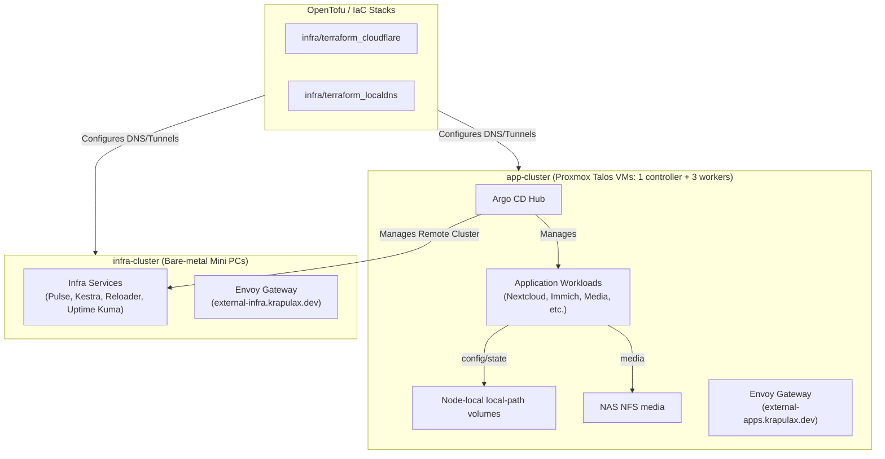

# ☸️ Dual-Cluster Installation & Deployment Guide

This guide provides a comprehensive, step-by-step installation and deployment process for the homelab Kubernetes estate managed by this repository.

> [!NOTE] > **Lineage & Origin**: This cluster architecture was originally bootstrapped from [`ajaykumar4/cluster-template`](https://github.com/ajaykumar4/cluster-template) (utilizing Talos Linux, Argo CD, and `bjw-s/app-template` patterns). It has evolved into a dual-cluster topology (`app-cluster` and `infra-cluster`) managed by a single central Argo CD GitOps hub.

---

## 🏛️ Architecture Overview



| Cluster             | Platform                          | Role                                                                                            | Kubeconfig Path                       |
| :------------------ | :-------------------------------- | :---------------------------------------------------------------------------------------------- | :------------------------------------ |
| **`app-cluster`**   | Proxmox VMs (Talos Linux)         | 1 controller + 3 workers; general workloads & Argo CD GitOps Hub                                | `./kubeconfig`                        |
| **`infra-cluster`** | Bare-metal Mini PCs (Talos Linux) | Independent 1 control-plane + 1 worker baseline infrastructure, monitoring, & fallback services | `./.private/infra-cluster/kubeconfig` |

The `infra-cluster` is a separate physical two-node cluster and is not changed by app-cluster rebuilds. Proxmox VM and host provisioning for the app cluster are owned by the standalone Terraform repositories (`home-dc-proxmox` and `home-dc-terraform`); this repository owns Talos configuration, Kubernetes manifests, and GitOps.

---

## 💻 Phase 1: Workstation Setup & Dependencies

Enter the Nix development environment to ensure all required CLI tools (`tofu`, `talosctl`, `kubectl`, `helm`, `sops`, `age`, `doppler`, `task`) are at exact, reproducible versions:

```bash
# Enter Nix dev shell

nix develop

# Install required Helm plugins and dependencies

task deps
```

Set up environment variables via `direnv` or standard exports:

```bash
cat > .envrc <<'EOF'
export KUBECONFIG="$PWD/kubeconfig"
export TALOSCONFIG="$PWD/talos/app/clusterconfig/talosconfig"
export SOPS_AGE_KEY_FILE="$PWD/age.key"
EOF
direnv allow .
```

---

## 🔐 Phase 2: Secret Engines & Key Management

### 🔹 1. Age Key for SOPS

The committed SOPS files (`*.sops.yaml`) and `.sops.yaml` in this repository are encrypted using the repository recipient (`age1saea3t7l67lavg0ardepzys6egp50g82uvks98pk53xdlj57uf8sa2arcs`).

-   **Existing Cluster / Operator**: Retrieve the matching private Age key from secure storage (e.g. 1Password / Doppler / backup) and write it to `./age.key` (or `$SOPS_AGE_KEY_FILE`):
    ```bash
    # Ensure the private key file exists locally and is ignored by Git
    cat age.key
    ```
-   **New Repository Fork**: If bootstrapping a fresh repository fork with a new key pair:

    ```bash
    # 1. Generate key pair
    age-keygen -o age.key

    # 2. Extract public key recipient
    age-keygen -y age.key

    # 3. Update the recipient in .sops.yaml and re-encrypt all secrets
    task template:encrypt-secrets
    ```

### 🔐 2. Doppler Secret Management

Ensure access to Doppler project `home-dc-kubernetes`:

```bash
doppler login
doppler setup --project home-dc-kubernetes --config apps
```

---

## 🏗️ Phase 3: Infrastructure Provisioning

Provision the app-cluster guests from `../home-dc-terraform` using a reviewed Proxmox plan. That repository owns the standalone VM state; **do not** use this repository's `tf:apply` to create VMs.

Cloudflare and local DNS remain independent OpenTofu stacks under `infra/`. Review their scoped plans now, but **defer apply until the replacement cluster, ingress and application routes are healthy** so DNS does not cut over prematurely:

```bash
CLOUDFLARE_DOPPLER_CONFIG=dev task tf:cloudflare:plan
task tf:localdns:plan
```

The Cloudflare plan currently removes only the retired Linkwarden Access application; defer that apply until the route cutover. The local-DNS plan is **blocked** because the scoped Doppler `infra` config lacks `UNIFI_USERNAME`, `UNIFI_PASSWORD` and `UNIFI_API_URL`. Do not invent credentials or apply an unreviewed UniFi stack: Technitium, not UniFi, is authoritative for the active `krapulax.home` zone. The Tdarr UniFi record removal can be reviewed separately if that stack is still owned here.

---

## ☸️ Phase 4: Talos Cluster Bootstrap

### ☸️ 1. Provisioning `app-cluster`

The replacement app cluster has one controller (`k8s-ctrl-01`, `10.0.40.90`) and three workers (`k8s-wrkr-01-gpu` `10.0.40.95`, `k8s-wrkr-02` `10.0.40.96`, `k8s-wrkr-03` `10.0.40.97`). Confirm the VMs have the new dedicated data disks and are in Talos maintenance mode before proceeding. Verify the worker user-volume mounts **after** applying configuration; they do not exist before Talos config is applied.

```bash
# Run once on a fresh app cluster only. This generates configs, applies to all
# four maintenance-mode nodes insecurely, bootstraps etcd and fetches kubeconfig.
task talos:app:bootstrap
```

Do not run `task talos:app:apply-node` for initial maintenance-mode installation: that task checks authenticated machine config first. Never rerun the Talos bootstrap task against an existing etcd cluster. Confirm the three worker user volumes at `/var/mnt/local-path-provisioner`, then run `task bootstrap:network` to install Cilium while nodes are `NotReady`. Verify all four nodes become `Ready` before installing the remaining platform charts.

On a workstation routing `10.0.0.0/16` through Tailscale, the app-cluster VIP may be unreachable even when it is healthy from the PVE LAN. `task talos:app:kubeconfig-direct` switches only the **ignored local kubeconfig** to the controller IP for bootstrap operations; `task talos:app:kubeconfig-vip` restores the intended VIP after client routing is fixed. Do not change the Talos cluster endpoint or the physical infra-cluster route to work around a workstation problem.

### ☸️ 2. Existing `infra-cluster` (Physical Mini PCs)

The independent two-node physical cluster is **unchanged**. Do not run `talos:infra:bootstrap`, `talos:infra:kubeconfig` or `talos:infra:cilium` during this app-cluster migration. Read-only checks may use `.private/infra-cluster/kubeconfig`; see [the existing infra-cluster runbook](../INFRA_CLUSTER_BOOTSTRAP.md) only if separately recovering that cluster.

---

## ☸️ Phase 5: GitOps Hub & Dual-Cluster Argo CD Bootstrap

1. **Install the platform without starting applications**:

    ```bash
    task bootstrap:platform
    ```

    This installs the remaining Helmfile bootstrap charts, including Argo CD, but does not create the Argo app-of-apps. Keep existing stateful applications stopped until backups and restore/fresh-start decisions are recorded. Do not run `task sync-argo-bootstrap` earlier: it bypasses this gate.

2. **Verify the local GitOps destination**: Fresh Argo CD knows its own cluster as `in-cluster`, but these Applications use the stable destination name `app-cluster`. `task bootstrap:platform` creates that alias declaratively through the Argo CD Helm values; verify `app-cluster` appears in `argocd --core cluster list`. No second app-cluster registration task or token Secret is needed.

3. **Reconnect the existing `infra-cluster` destination**: The new Argo hub has no reusable remote-cluster credential. With explicit operator approval for the limited `argocd-manager` ServiceAccount/RBAC registration (not a Talos or workload change), run the reproducible task:

    ```bash
    task clusters:register-infra
    ```

    This creates the `argocd` client context locally and adds the infra-cluster credential to the new app-cluster hub. Verify with `task clusters:status`. To roll back registration, remove only the `infra-cluster` cluster Secret from the app-cluster `argo-system` namespace; leave the previously existing infra ServiceAccount/RBAC intact. Do not rerun the physical cluster bootstrap.

4. **Start GitOps only after the storage, source-revision and data gates**: Record per-application restore or deliberate fresh-start decisions and run `task secrets:validate-bootstrap`. Merge the reviewed refactor to remote `main`: all Argo Applications and their sources track `main`, and syncing sooner would recreate retired apps and Ceph. Then run `task apps:bootstrap` to create the root Argo Applications; it does not bootstrap the physical cluster.

    Initial GitOps sync does **not** make apps public: the app-cluster `cloudflare-tunnel` ingress permits only the exact `argo.krapulax.dev/api/webhook` path (needed for webhook delivery), with a 404 fallback; `cloudflare-dns` has no automated sync. Existing DNS records may already point at this tunnel, so deferring Terraform alone is **not** a safety gate. Inspect the live tunnel rule matches, verify app hostnames and other Argo paths do not reach their origins (Cloudflare Access may challenge before the tunnel's 404), and test the webhook externally. After app health, off-host backup and restore checks, promote a reviewed Git revision restoring the public ingress and DNS automation; see `docs/plan/app-cluster-standalone-refactor.md`. Never enable the wildcard connector during initial app bootstrap.

---

## 💾 Phase 6: Application Structure & Storage Standards

Workloads are committed under cluster-specific directory trees:

```text
kubernetes/
├── apps/
│   ├── app-cluster/           # Workloads targeting app-cluster
│   │   ├── default/
│   │   ├── media/
│   │   └── productivity/
│   └── infra-cluster/         # Workloads targeting infra-cluster
│       ├── monitoring/
│       └── automation/
└── argo/
    └── apps/
        ├── app-cluster/       # Argo Application manifests targeting app-cluster
        └── infra-cluster/     # Argo Application manifests targeting infra-cluster
```

### 💾 Storage Conventions (Strict Rule)

-   **Application Configs / Databases**: Use `storageClass: local-path` for all configuration and database PVCs across all namespaces. Use `accessMode: ReadWriteOnce` and rely on the `Retain` reclaim policy so PVC deletion preserves the underlying PV. Workloads that share a volume must be co-located on the same worker; do not reschedule a pod to another worker without restoring its data.
-   **Media & Downloads**: Use `existingClaim: media-library-pvc` (NFS share at `10.0.40.2:/media`). Never create new PVs with `Delete` reclaim policy.
-   **Backup Gate**: Do not mark a stateful app "live" until an off-node backup has been taken and a restore to a fresh local-path volume has been verified. Node-local volumes do not survive worker disk or host failure.

---

## ✅ Phase 7: Verification & Health Checks

Verify total cluster health across both control plane and workloads:

```bash
# Verify app-cluster and infra-cluster statuses

task clusters:status

# Verify Kubernetes node readiness

kubectl get nodes -o wide

# Check Argo CD sync status

argocd app list

# Run comprehensive verification suite

task verify:cluster
```

## ↩️ Phase-Specific Rollback Procedures

If an installation step fails or requires reversal, follow the corresponding phase rollback procedure:

### 🏗️ Rollback Phase 3: Infrastructure Provisioning (OpenTofu)

-   **Cloudflare Tunnels & DNS**: To revert DNS or tunnel changes:
    ```bash
    task tf:cloudflare:destroy
    ```
-   **Full Infrastructure Teardown**: Destroy all OpenTofu stacks in reverse dependency order:
    ```bash
    task tf:destroy
    ```

### ☸️ Rollback Phase 4: Talos Cluster & Node Reset

-   **Reset Nodes**: To wipe etcd, destroy cluster state, and return nodes back to maintenance mode:
    ```bash
    task talos:reset
    ```
-   **Reintroduce or Replace Workers**: To restore worker capacity, update `talos/app/talconfig.yaml`, regenerate Talos config (`task talos:app:generate-config`), and re-apply machine configs. Restore stateful app data from off-node backups onto the new local-path volumes; RWO volumes cannot be moved between workers.
-   **Controller Failure**: With a single controller, loss of `k8s-ctrl-01` makes the Kubernetes API unavailable. Recover from Talos/etcd backups or rebuild the controller; worker local-path data remains on disk but cannot be managed until the control plane is restored.

### ☸️ Rollback Phase 5: Argo CD & Remote Cluster Registration

-   **Unregister Spoke Cluster**: Remove `infra-cluster` from the Argo CD hub running on `app-cluster`:
    ```bash
    argocd cluster rm infra-cluster
    ```
-   **Repoint Argo CD Hub**: To repoint Argo CD to an earlier repository or branch:
    ```bash
    kubectl -n argo-system apply -f kubernetes/components/common/repositories.yaml
    ```

### ↩️ Rollback Phase 6/7: Workload GitOps Rollback

-   **Disable Auto-Sync**: Pause the `apps` parent first so its self-heal does
    not restore the child's Git-declared policy while you investigate:
    ```bash
    argocd app set apps --sync-policy none
    argocd app set <app-name> --sync-policy none
    ```
-   **Revert Git State**: Revert the workload commit on your git branch and push.
-   **Resume GitOps**: Reapply the bootstrap policy and reconcile the apps:
    ```bash
    task sync-argo-bootstrap
    task reconcile
    ```

---

## 🚑 Troubleshooting & Maintenance

-   **Lens Setup**: Generate a combined kubeconfig for Lens cluster browsing:
    ```bash
    task clusters:lens-kubeconfig
    ```
    Import `.private/lens.kubeconfig` into Lens.
-   **Node Upgrades**: Upgrade Talos OS version safely:
    ```bash
    task talos:app:upgrade-node IP=10.0.40.90 VERSION=v1.9.0
    ```
-   **Secrets Troubleshooting**: If `DopplerSecret` fails to sync, check doppler-operator logs:
    ```bash
    kubectl logs -n doppler-operator-system deployment/doppler-operator-controller-manager
    ```
