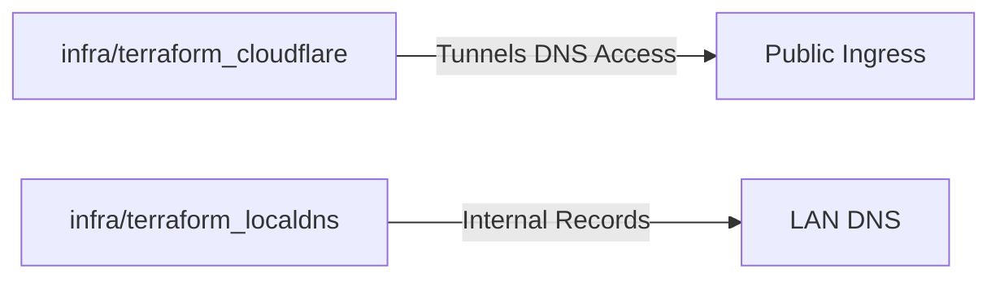

# 📄 OpenTofu Setup

> This page describes the remaining OpenTofu stacks after the legacy Proxmox/Talos root was removed. Cloudflare and local DNS stacks remain here; the standalone guests are provisioned from `../home-dc-terraform`.

## 📌 Stack Layout



-   `infra/terraform_cloudflare/`: Kubernetes Cloudflare tunnel, DNS, Access policies, and tunnel credentials.
-   `infra/terraform_localdns/`: Kubernetes local DNS infrastructure.

The legacy `infra/terraform_proxmox/` root has been removed from version control. Its ignored local state files (`.terraform/`, `*.tfstate`, `*.tfvars`, `tfplan*`, etc.) were left in place and must still be treated as operator-local secret material.

## 📌 Assumptions

-   Proxmox VM and Talos cluster lifecycle is handled outside this repository.
-   Only Cloudflare and local DNS resources remain Terraform-managed.
-   Local state is kept in the repo working copy for now and must be treated as operator-local secret material.
-   `.terraform/`, `.terraform.lock.hcl`, `*.tfstate`, `*.tfvars`, `*.auto.tfvars`, and `tfplan*` are ignored across all stack directories.

## 📌 Common Commands

```bash
task tf:init
task tf:plan
task tf:apply
```

Execution order:

-   `task tf:init` initializes Cloudflare, then local DNS.
-   `task tf:plan` plans the same order.
-   `task tf:apply` applies the same order.
-   `task tf:destroy` runs the reverse order.

Each stack also has a scoped task path:

```bash
CLOUDFLARE_DOPPLER_CONFIG=dev task tf:cloudflare:plan
task tf:localdns:plan
```

Cloudflare Terraform requires an explicit Doppler config, for example
`CLOUDFLARE_DOPPLER_CONFIG=dev`. The selected config must contain the
Cloudflare token, account ID, zone ID, plus `DOPPLER_APPS_TOKEN` and
`DOPPLER_INFRA_TOKEN`: separate write-enabled service tokens for the `apps`
and `infra` configs respectively.

## 📌 Validation

After any change, run a plan against both remaining stacks to confirm no
unexpected drift:

```bash
CLOUDFLARE_DOPPLER_CONFIG=dev task tf:cloudflare:plan
task tf:localdns:plan
```

Both plans should show only the changes described in the current change set.

## 📌 Rollback

Because the Proxmox/Talos stack was removed from version control, the only
remote side effects come from applying the remaining Cloudflare or local DNS
stacks. To roll back a bad apply:

1. Do not delete any ignored local state files under `infra/terraform_*/`.
2. If the Proxmox directory is ever manually removed, archive the entire
   `infra/terraform_proxmox/` directory offline (including `.terraform/`,
   `*.tfstate`, `*.auto.tfvars`, and `tfplan*`) before deletion so VM IDs and
   prior state can be recovered.
3. Restore the previous known-good Terraform configuration and run a scoped **plan** against the affected Cloudflare or local-DNS root. Review resource addresses and state before any apply; do not use aggregate destroy as a rollback.
4. If the Proxmox directory is restored, recover its tracked files and local state together before running any command against it. Never apply the legacy Proxmox root to the standalone VMs.

### Legacy Doppler state migration

Older local Cloudflare state can retain tunnel-secret records under
`project-homelab/dev_homelab`, even though the Terraform configuration writes
to `home-dc-kubernetes`. After confirming the existing `TUNNEL_TOKEN_APPS`
and `TUNNEL_TOKEN_INFRA` secrets are in the destination configs, run:

```bash
CLOUDFLARE_DOPPLER_CONFIG=dev CONFIRM_STATE_MIGRATION=1 task tf:cloudflare:migrate-doppler-state
CLOUDFLARE_DOPPLER_CONFIG=dev task tf:cloudflare:plan
```

The task first verifies all six legacy bindings, copies the local state file,
then removes them before importing the two existing tunnel-token records. The
next plan creates the four missing credential and ID secrets in the target
configs. If an import fails, the task restores the local state backup. It never
deletes Doppler secrets. Review the resulting plan; stale N8N Cloudflare Access
entries may still be proposed for deletion if their decommissioning has not
previously been applied.

## 🚚 Migration Notes

-   The legacy mixed `terraform/` root and the `infra/terraform_proxmox/` stack
    have been removed from version control. Proxmox resource addresses are no
    longer managed here.
-   Cloudflare and local DNS resources in this repository remain Kubernetes-owned.
-   No Ceph infrastructure resources remain in this repository.
-   Rollback of the repository change itself is a directory/state-file restore
    from git history or backups before applying changes; no remote resources are
    changed by the cleanup itself.

## 📌 Related Documents

-   [Architecture Plan](../architecture/ARCHITECTURE_PLAN.md)
-   [Cluster Docs Overview](../cluster/README.md)
