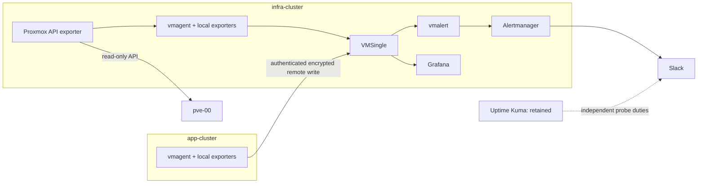

# VictoriaMetrics monitoring and Pulse replacement plan

Status: **implementation in progress**, not deployed. Pulse was retired in PR #460; host, VM and Kubernetes alerts are unavailable until their replacements are verified. Kubelet and cAdvisor collection are explicitly disabled pending a trusted serving-certificate path. The separate Argo split is not a prerequisite.

## Goal and decision

Run a GitOps-managed monitoring control plane on the independent physical **infra-cluster**, with visibility into both Talos clusters, standalone `pve-00` and Proxmox Backup Server (PBS); add QNAP only if its supported interfaces and security posture are verified. The operator accepts retiring Pulse before the replacement is deployed to free resources. This creates a monitoring and alerting gap; record the current Pulse coverage and preserve rollback before removal. Retain Uptime Kuma/AutoKuma during the gap and initially after deployment.

Use the VictoriaMetrics Kubernetes stack as the implementation baseline: **VMSingle** for metrics, **Grafana** for dashboards, **vmalert** for rule evaluation and Prometheus **Alertmanager** for grouping/routing to the existing Slack monitoring channel. Add Discord later as an alternative receiver, not a second unsolicited notification stream. A local **vmagent per cluster** discovers and scrapes its own Kubernetes targets, assigning a mandatory stable `cluster` label, and remote-writes to VMSingle on infra-cluster. Use the upstream stack/operator where useful; do not deploy a second Grafana, VMSingle, vmalert or Alertmanager on app-cluster. Pin reviewed chart and image versions/digests at implementation, not an unverified current version in this plan.

**Failure boundary:** both the central stack and its local alert delivery run on infra-cluster and share the NAS/network dependencies used by other services. A complete infra-cluster outage, failed Alertmanager, blocked internet, or failed Slack webhook cannot reliably alert itself. External dead-man monitoring was previously deferred; record this gap explicitly and design an externally hosted heartbeat receiver later, rather than claiming full outage coverage.

## Observed baseline and assumptions

-   Live read-only node inventory: app-cluster `k8s-ctrl-01` at `10.0.40.90`, workers `.95`, `.96`, `.97`, Talos 1.13.8 / Kubernetes 1.36.3; infra-cluster `infra-cp-01` `10.0.40.31`, `infra-wk-01` `.32`, Talos 1.13.6 / Kubernetes 1.36.2. Recheck at deployment, including capacity and scheduling restrictions.
-   Existing `pulse-infra` runs on `infra-wk-01`, uses `/var/pulse/data` and requests 250m CPU / 512 MiB, limit 1 CPU / 2 GiB. Its daemonset uses privileged host network/PID access. Its configured PVE polling interval is 30 seconds. Exact live Pulse integrations, notification rules, historical retention and host-agent installation are **not yet inventoried**; inspect without printing credentials. Host-level monitoring changes belong in `../home-dc-proxmox`.
-   Uptime Kuma/AutoKuma run on `infra-wk-01`; generated public HTTP probes cover Argo, DNS UI, homepage, Jellyfin, Immich and other sites, generally at 60 seconds with three retries. Kuma state uses embedded MariaDB; preserve both `/var/uptime-kuma/data` and `/var/autokuma/data`, credentials, monitors and notification settings. Do not delete Kuma or its history during this project by default.
-   App manifests already expose several `ServiceMonitor`/`PodMonitor` objects, including Cilium, cert-manager, Envoy, metrics-server, Cloudflare tunnel and Reloader. Their presence is **not** proof the target is live, accepted, or currently scraped. A live read found Prometheus ServiceMonitor/PodMonitor CRDs in app-cluster; the same queried CRDs were absent on infra-cluster. Inventory actual endpoints/CRDs and owners again before selecting CRD/conversion settings. Avoid duplicate ownership, duplicate scrape jobs and silently dropping namespaces.
-   `pve-00` is one standalone PVE, not a cluster. Its `rpool` and `slow` are currently single-disk ZFS pools; errors, capacity and pool health are high-value. PVE exporter access/metric completeness, SMART/temperature and exact host network policy are **not validated**. Quadro P2000 is passed through to the app VM; host GPU collectors cannot assume visibility.
-   PBS is configured in `home-dc-terraform` as LXC 4020 at `10.0.40.20:8007`, with `home-dc` datastore on NAS NFS. The live HTTPS endpoint responded 401 without authentication; through trusted `pve-00`, PBS reported 4.2.8 and its ED25519 host key matched the offered key. The workstation's direct SSH host key is stale; do not bypass verification. PBS exporter credentials, datastore/task metrics and certificate trust are not yet verified. The Terraform runbook notes NFS-backed PBS datastores are not documented as supported upstream; verify GC and restore independently.
-   NAS `10.0.40.2` serves `/media` and `/k8s-backup`. QNAP model, firmware, exposed SNMP endpoints/MIBs and permission to enable SNMP remain unverified. No vendor credentials, secrets or SNMP communities in Git.
-   The current Argo hub runs on app-cluster and manages infra-cluster. The monitoring runtime can survive an app-cluster failure **after** it is deployed, but initial deployment and GitOps reconciliation still depend on that hub until the separate Argo-split project completes.

## Topology, security and state

### Central services on infra-cluster

1. Argo Application(s) under `kubernetes/argo/apps/infra-cluster/monitoring/`; workload configuration under `kubernetes/apps/infra-cluster/monitoring/`. Separate CRD/operator ownership from application resources and use explicit sync waves, immutable versions and server-side apply where needed. Prove upgrade and deletion semantics before enabling pruning of shared CRDs. Existing Prometheus CRDs must not be removed or stolen from their current owner.
2. Start with VMSingle, not VMCluster: the infra cluster has only one worker and there is no demonstrated need for distributed storage. Configure persistent data on the infra cluster's existing suitable retained storage class after verifying its binding/space semantics; do not assume the app-cluster local-path policy applies to physical infra. Specify an initial **30-day retention**, 30-second general scrape and 15-second only for justified critical targets; adjust after a representative cardinality/bytes-per-day measurement. Set explicit requests, limits and disk free-space alerts. Sizing is a starting hypothesis, not a capacity guarantee.
3. Provision Grafana dashboards, datasources, folders, alert rules and routing declaratively in Git. Store Grafana admin/session secrets and webhook/API tokens in scoped Doppler secrets; no plaintext in Git, annotations or log output. Prefer read-only viewer access and authenticated admin access. Use an internal `grafana.krapulax.home` HTTPRoute/ExternalDNS record, no new public route. Review TLS/trusted-LAN risk and authentication before considering public access. Keep VMSingle write/query, vmagent, exporter and Alertmanager endpoints private; restrict ingress/egress and service accounts to required peers.
4. Grafana's database may be Git-reconstructable only if dashboards, users and settings are actually provisioned. Explicitly inventory and back up non-Git state, Alertmanager silences if preservation is required, and repository/credential recovery. Metrics history has a separate retention/restore decision: a metrics PVC with `Retain` is not a backup. Enroll protected state in the existing Backrest/app-protect workflow or explicitly opt out with documented consequences; test restore to fresh storage. No claim that existing backup plans automatically cover these new components.
5. Alertmanager receives alerts only from vmalert; configure Slack from Doppler using the established monitoring secret, and prove firing **and resolved** delivery. Use grouping by cluster/alertname and inhibition so node loss suppresses downstream pod/target cascades. Critical alerts notify immediately after their hold period; warnings are grouped and delayed. Keep a Git-owned test alert, mute policy and runbook links. Secrets are restricted to the relevant namespace and never printed in CI.

### Collection in both clusters

-   One vmagent in each cluster; local service discovery and least-privilege read-only RBAC in that cluster. Install node-exporter on schedulable **and control-plane nodes** only after checking Talos security/host mounts and node taints; run kube-state-metrics per cluster. Measure actual kubelet/cAdvisor/API server/controller-manager/scheduler/etcd endpoint availability and TLS on Talos: do not disable TLS verification or expose admin ports to make dashboards green. Where secure endpoints are unavailable, explicitly record a gap and use supported Talos metrics/operational checks. Ensure metrics for both control planes, worker nodes and all namespaces.
-   VictoriaMetrics operator can convert Prometheus `ServiceMonitor`/`PodMonitor` objects, but conversion is not necessarily automatic across clusters or namespace selectors. Choose one owner/conversion strategy **per cluster**; use operator conversion plus matching Prometheus CRDs where safely supported, or explicitly migrate monitors to VM-native resources. Verify rendered CRDs and scrape targets; never assume cross-cluster conversion. Avoid both direct and converted copies of the same target.
-   Add `cluster=app-cluster` / `cluster=infra-cluster` via external labels and stable `environment=lab`; ensure these cannot be overwritten by scraped targets. Preserve meaningful `namespace`, `node`, `job`, `instance`, and application labels. Keep pod UID, filenames, URLs, user IDs, API keys and unbounded resource labels out of metric dimensions; test cardinality and label collision behavior.
-   App vmagent remote-writes to a **private infra endpoint** through a restricted, TLS-authenticated proxy or equivalent explicit authenticated transport. VMSingle is not assumed to supply authentication itself. Validate certificates/hostnames, peer identity, allowed paths and destination reachability from both clusters. Prefer a restricted remote-write path, not a public UI or open write API. Use a bounded persistent queue with measured disk limits, tested behavior on queue-full, retries, outage/restart, backlog drain and visible dropped samples. Once central storage returns, verify late data actually arrives. Initial queue capacity: target 24 hours of observed ingestion plus headroom, adjusted for disk budgets; do not claim durability before testing.
-   Host metrics that require privileged host access or sensitive `/proc`, `/sys`, sockets or kubelet permissions need a specific exception and review. No privileged Pulse-equivalent agent by default. The GPU worker needs a separately evaluated NVIDIA DCGM exporter/device-plugin integration; verify Quadro P2000/driver compatibility and device scheduling before promising utilization, memory, temperature or transcode metrics. Jellyfin stream/transcode visibility may need an app exporter; validate source and do not expose user/viewing details in labels.

### Proxmox and optional QNAP

-   Deploy a maintained Prometheus PVE API exporter in infra-cluster using a **separate read-only PVE API token**, minimum audited role/ACL (PVEAuditor is a starting point, not proof every desired API call is allowed); secret from Doppler, never reuse Terraform credentials. TLS: verify the actual PVE certificate trust/hostname or install a reviewed CA; no `verify_ssl: false` permanent shortcut. Limit exporter target configuration and network reachability to the known `pve-00`; do not expose its multi-target `/pve` endpoint publicly or let arbitrary users select targets. Document host IP from live source during rollout rather than hard-coding an unverified address.
-   PVE API metrics cover node/guest/storage status, not automatically every physical SMART/NVMe, temperature, filesystem, ZFS health or VM backup-result signal. Inventory exporter output against Pulse, PVE backup schedules and actual `pve-00` capabilities. If gaps remain, evaluate a minimal host exporter/collectors managed idempotently by `home-dc-proxmox`, with firewall, read-only permissions and no SSH credentials in Kubernetes. Verify SMART and ZFS health on both single-disk pools; if a collector cannot supply it, keep an explicit manual/host-native alert until it can.
-   PBS coverage is mandatory. Evaluate [PBS exporter](https://github.com/natrontech/pbs-exporter): documented snapshot age, verify status, datastore capacity and process metrics are useful, but its README reports testing on PBS 3.x; validate PBS 4.2.8 and task/GC/prune/sync/verify coverage against live APIs. Use a separate least-privilege read-only PBS token and trusted TLS, never admin, backup or Terraform credentials. Alert on PBS unavailable, failed/missed jobs, verification/GC failures, expected guest backup age, datastore capacity and NFS loss; explicitly mark unsupported metrics and preserve existing backup jobs/data.
-   QNAP is optional and must not block Pulse retirement for PVE/Kubernetes parity. First determine whether the NAS supports and permits **SNMPv3 authPriv** and usable vendor MIBs, with a restricted read-only account and ACL limited to infra vmagent/exporter. Run an SNMP exporter inside infra-cluster only after read-only discovery and operator approval; track NAS availability, volumes/pools, disk health, temperatures, capacity and backup-share filesystem if exposed. Never enable insecure SNMPv1/v2c on public networks or reuse the admin account. Independently test existing NFS mounts and NAS reachability even if vendor telemetry is unavailable; NFS success is not disk health or backup success.

## Coverage and initial alerts

Thresholds below are proposed starting points, to be calibrated to observed usage and available metrics. An alert must have a source metric, cluster/target labels, severity, hold time, actionable runbook and verified firing/resolved delivery. No placeholder rules may claim to monitor a missing metric. Distinguish zero, stale, absent and unknown; missing exporter data must not be graphed as healthy.

| Domain                   | Dashboard / signals                                                                                                                                                                    | Initial alert and hold / verification                                                                                                                                                                                                                                                                                         |
| ------------------------ | -------------------------------------------------------------------------------------------------------------------------------------------------------------------------------------- | ----------------------------------------------------------------------------------------------------------------------------------------------------------------------------------------------------------------------------------------------------------------------------------------------------------------------------- |
| Monitoring pipeline      | Per-cluster scrape targets, sample rates/cardinality, remote-write queue/backlog/drops, VMSingle storage and ingestion, rule evaluation, alert delivery                                | Target missing 10m; queue growing 15m or drops >0; VMSingle disk <20% 15m / <10% 5m; rule evaluation failures 10m. Simulate agent/network loss and confirm recovery. Heartbeat failure needs an external receiver to catch total infra outage.                                                                                |
| Both Kubernetes clusters | Node Ready, API/etcd health where securely available, capacity/requests, CPU/memory/disk pressure, filesystem/inodes, networking, pod and workload health, restarts, OOM, pending pods | NotReady 5m, controller/API unreachable 3m, worker pressure 10m, PVC pending 15m, pod crash/restarts sustained 15m; disk/inodes <15% warning / <10% critical 10m. Silence during reviewed maintenance.                                                                                                                        |
| Critical services        | Argo sync/health, DNS endpoints, Envoy, Cloudflare tunnels, Doppler reconciliation, Backrest and app-protect, ingress/cert expiry                                                      | Missing target 10m; unhealthy replicas or tunnel down 5m; certificate expires <14d warning / <7d critical; GitOps sync failure 15m. Verify metrics exist and cover both clusters. Backup alerts must report **per-source capture age**, missed jobs and restore/check failures, not just an up process or snapshot timestamp. |
| PVE                      | Host/VM state, CPU/RAM, storage capacity, `rpool`/`slow` health and errors, disk SMART/temperature where supported, backup jobs                                                        | `pve-00` unreachable 5m; expected VM stopped 5m; pool degraded immediately after 2m confirmation; usage >80% warning / >90% critical 15m; recent failed/missed VM backups only if reliably exported. Do not alert on deliberately stopped guests without explicit inventory.                                                  |
| PBS                      | Availability, datastore usage, backup freshness and verification per expected guest, task/GC/prune/sync/verify outcomes, underlying NFS dependency                                     | PBS unavailable 5m; backup or verification stale beyond its actual job SLA; failed jobs on confirmed failure; datastore <20% warning / <10% critical 15m. Verify PBS 4.2.8 exporter coverage and suppress intentional maintenance.                                                                                            |
| GPU/media                | GPU utilization/memory/temperature if supported; Jellyfin availability and transcode capability, Immich/DB availability                                                                | GPU/exporter missing or abnormal temperature only once supported and measured. Validate a real GPU transcode; never infer GPU usage from video playback alone.                                                                                                                                                                |
| NAS / QNAP optional      | NFS reachability and storage capacity; optional vendor pool/disk/thermal metrics                                                                                                       | NFS error/unavailable 5m; available <20% warning / <10% critical 15m, tied to actual filesystem not PVC request. If SNMP unavailable, show explicit unknown for NAS hardware health.                                                                                                                                          |
| User journeys            | Kuma public URL probes, internal HTTP/DNS checks, critical webhook/Cloudflare path                                                                                                     | Preserve existing Kuma monitors and notifications; compare route inventories. Distinguish external probing from in-LAN hairpin probes and distinguish an HTTP 200 from an authenticated workflow.                                                                                                                             |

Use upstream Kubernetes dashboards/rules as a starting point, then provision concise overview, per-cluster/node/workload, PVE/storage, network/ingress, backups and optional GPU/NAS dashboards. Include freshness/last scrape and cluster labels on overview panels. Imported dashboards must be pinned and reviewed; no deploy-time fetching from mutable public URLs. No logs/traces stack is required for this replacement.

## Phased implementation and acceptance

**Backup enrollment:** the Pulse enrollment and `app-pulse` plan were removed together in PR #460; their live CronJob and plan were verified absent. Its retained data and snapshots were not deleted. Metrics history is explicitly opted out of app-protect; Grafana configuration and dashboards must be Git-provisioned because Grafana has no persistent database.

**Chart review gate:** official Helm repository chart `victoria-metrics-k8s-stack` 0.97.0 defaults to `kubelet.vmScrape.spec.tlsConfig.insecureSkipVerify: true`, a blackhole Alertmanager receiver, and a sync Job downloading dashboards/rules from mutable upstream branches. Override these defaults: verify kubelet server identities and trusted CAs, configure and exercise the scoped Slack route with firing/resolved delivery, and pin/vendor reviewed dashboard and rule artifacts. Inspect the **rendered** manifests and live connections; Helm values alone do not prove the resulting security or alert route. No chart has been deployed.

**Kubelet TLS observation:** direct verification against each cluster's kubeconfig CA failed for all six kubelets on port 10250. Unverified certificate inspection showed node-specific issuers and only node DNS names in the SANs, not node IPs. Those inspected certificates are not independently trusted identities. Neither API server advertises `--kubelet-certificate-authority` in its static pod command, so proxying through the API server does not establish verified end-to-end kubelet identity. Do not use the chart's insecure TLS default; establish a verified node-serving CA and DNS identity or another demonstrably authenticated collection path.

**Verified implementation prerequisites:** scoped Doppler-managed Slack, Grafana and exporter credentials are referenced without exposing values. Helm chart `0.97.0` renders no kubelet scrapes, TLS verification bypasses or operator pre-delete cleanup Job with the current values. Isolated hardened PVE and PBS exporters successfully scraped their respective systems with independently verified TLS and separate audit-only credentials. The PBS exporter reports datastore capacity and snapshot timestamps on PBS 4.2.8. PVE host-level SMART/ZFS and complete PBS task/GC/prune/sync coverage are not implemented or verified.

**Read-only baseline evidence:** the natural 2026-10-31 database backup schedules succeeded in both clusters, and the next daily app-protect jobs/plans succeeded on 2026-11-01. An earlier Jellyseerr plan failed twice before later success. Pulse snapshot `4153a786a93c5d95dda1371eee7471894db9dceb00ee9fe1c0c51c34020321f4` restored via Backrest operation `73` to a disposable directory: 58 files, 646,768,028 bytes. An isolated pod mounted that restore read-only and verified `PRAGMA integrity_check` returned `ok` for all six SQLite files. A separate temporary pod copied the restored data to ephemeral storage and started the Pulse image; its local HTTP endpoint returned 200. A deny-ingress/egress NetworkPolicy and an in-pod connectivity check prevented access to PBS during the test. The test did not verify historical records, cross-database consistency or notification functionality; retain `/var/pulse/data` and credentials for rollback. Both live Pulse Argo Applications currently have no finalizers. A read-only `systemctl` check found no `pulse-agent.service` on `pve-00`.

1. **Baseline / gates.** Finish or respect the current 24-hour backup observation and roadmap prerequisites. Inventory Pulse nodes, services, checks, active alarms, notification destinations and host agents without disclosing secrets; preserve its configuration and `/var/pulse/data`, document history retention and the temporary coverage/alerting gap, and verify rollback prerequisites. Inventory existing ServiceMonitor/PodMonitor CRDs/owners, current PVC capacity/headroom and Kuma public monitors. Check `pve-00` exporter permissions/TLS and optional QNAP capability. Establish a coverage matrix from the preserved Pulse baseline.
2. **Early Pulse retirement, separate PR.** The operator accepts retirement before replacement. Remove its Kubernetes Application, daemonset/RBAC, host agents only through their owning repo, routes and generated Kuma `pulse` monitor after inventory. Preserve `/var/pulse/data`, credentials and rollback references; do not delete unrelated state or agents. Verify orphan cleanup, Kuma and remaining notification paths. Record unavailable host, VM and Kubernetes alerts explicitly until replacement covers them; Kuma is not equivalent. No seven-day overlap is possible with this ordering.
3. **GitOps foundation.** Design/PR namespace, exact chart/operator version, CRDs/conversion, RBAC, network/TLS, Grafana provisioning, retained storage and Doppler secret references. Render locally and validate with destination server dry-runs; review Argo hook/CRD lifecycle and secret rotation. Deploy central components and infra collection while preserving Kuma. Prove dashboards from real infra nodes; measure CPU/RAM/PVC usage and ingestion/cardinality.
4. **App collection.** Deploy app-side vmagent/exporters with correct cluster label and bounded persistent queue. Verify all four app nodes and both infra nodes appear once, per-namespace discovery including current monitors, and no duplicates. Induce a limited remote-write interruption in a non-production/test target; prove queue durability, replay, bounds, drops/alerts and recovery without changing Talos physical nodes or stopping apps.
5. **PVE and optional QNAP.** Create a separate least-privilege PVE token using the host-repository workflow; prove read-only access, verified TLS and expected guest/storage/backup metrics. Add host exporter only for measured gaps with reviewed `home-dc-proxmox` PR. If SNMPv3 is authorized and proven, add QNAP; otherwise mark hardware signals unavailable and continue without QNAP.
6. **Rules, dashboards, notifications.** Provision coverage matrix, scoped thresholds and runbooks. Exercise synthetic non-destructive firing and resolved messages to a dedicated/test Slack route before production. Verify grouping/inhibition, repeat intervals, scrape-missing vs target-down, certificate and backup-freshness rules, remote-write outage and Alertmanager restart. Review dashboards visually for each cluster, host and backup path. Keep Uptime Kuma notifications and probes; remove duplicate alerts only with an explicit inventory.
7. **Acceptance and recovery.** Compare new telemetry and alerts against the preserved Pulse baseline, document gaps, and run the replacement for at least seven days including normal workload and backup cycles. Validate a Grafana/central configuration restore from independently accessible credentials and fresh storage; separately restart collector, vmalert and Alertmanager to test recovery, while retaining Kuma. Measure storage growth; adjust retention/queue and thresholds. Close the monitoring gap only when the coverage matrix and delivered firing/resolved notifications are accepted.

## Validation, risks and rollback

-   **Before implementation:** verify actual source hardware/version inventory, PVE API ACL, TLS, available disk, namespaces and metric endpoint discovery; keep precise secret values private. Pin chart/exporter dependencies, review license and update policy. Check Argo's shared CRD ownership and advertised chart caveats: Helm lookup-generated certs/passwords, oversized dashboard annotations and unsupported pre-delete hooks under Argo.
-   **Acceptance:** both clusters' six nodes represented with correct labels; useful PVE guest/storage and single-disk pool coverage; optional NAS explicitly classified; all critical services and backup freshness coverage mapped; successful Slack firing/resolution; verified queue recovery and isolated state restore; no unaccounted Pulse coverage gaps. A seven-day replacement observation and delivered end-to-end notifications are required before claiming the gap closed; early Pulse removal is an explicitly accepted risk, not parity evidence.
-   **Rollback before Pulse retirement:** leave Pulse/Kuma running and revert only new monitoring changes; preserve state, shared CRDs, PVCs and secrets.
-   **Rollback after early Pulse retirement:** revert the Pulse retirement PR, restore its retained data/secret references and original routes and host agent configuration, then sync through Argo; verify Pulse and notification delivery. Preserve new monitoring data if already deployed. A complete infra outage cannot be alerted by this in-cluster stack; external independent notification remains a separate prerequisite for that assurance.
-   **Known limitations:** one infra worker, one central VMSingle and Alertmanager, and a single PVE host are not HA. Monitoring on infra remains subject to infra, NAS, network and power failures. 30-day metric retention is not a disaster-recovery backup. QNAP and GPU telemetry are conditional; external uptime/dead-man is deferred; existing app-cluster Argo remains a deployment/reconciliation dependency.

## References

-   [VictoriaMetrics Kubernetes stack and Argo caveats](https://docs.victoriametrics.com/helm/victoria-metrics-k8s-stack/)
-   [vmalert and Alertmanager integration](https://docs.victoriametrics.com/victoriametrics/vmalert/)
-   [Prometheus PVE exporter and security model](https://github.com/prometheus-pve/prometheus-pve-exporter)
-   [Proxmox user, token and ACL model](https://pve.proxmox.com/wiki/User_Management)
-   Current manifests: `kubernetes/apps/infra-cluster/monitoring/` and `kubernetes/apps/app-cluster/`; PVE hardware: `../home-dc-proxmox/docs/hardware.md`; backup inventory: `docs/cluster/database-backups.md`.
