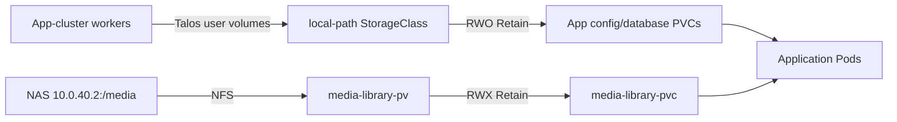

# 💾 Storage Overview

## 🏛️ Architecture Overview



The app-cluster uses two storage tiers:

1.  **Node-local `local-path` volumes** for application config, databases, and cache.
2.  **NAS-backed NFS** (`media-library-pvc`) for the shared media library and download paths.

There is **no Ceph cluster or Ceph CSI** in the app cluster. The standalone Proxmox/Ceph stack referenced historically has been retired for app-cluster storage.

### 🔹 Components

-   **Talos user volumes**: dedicated data disks on each worker, mounted at `/var/mnt/local-path-provisioner`.
-   **local-path-provisioner**: deployed from `kubernetes/apps/app-cluster/storage/local-path/`.
-   **StorageClass `local-path`**: `WaitForFirstConsumer`, `Retain`, restricted to Linux nodes.
-   **Static NFS PV/PVC**: `media-library-pv` / `media-library-pvc` at `10.0.40.2:/media`.

---

## 📋 Prerequisites

### ☸️ On Proxmox / Terraform

1.  The standalone Terraform repositories (`home-dc-proxmox`, `home-dc-terraform`) have provisioned the app-cluster worker VMs with dedicated data disks.
2.  Each worker data disk is visible to Talos and configured as a user volume named `local-path-provisioner`.
3.  The NAS export `10.0.40.2:/media` is reachable from every worker node.

### ☸️ On Kubernetes

1.  `local-path-provisioner` is deployed in the `local-path-storage` namespace.
2.  StorageClass `local-path` exists and is not the default.
3.  Static PV `media-library-pv` and PVC `media-library-pvc` exist in the `media` namespace.

---

## 📌 Setup Instructions

### 🔹 Step 1: Verify Talos User Volumes

On each worker node:

```bash
talosctl --talosconfig talos/app/clusterconfig/talosconfig -n <worker-ip> get volumestatus u-local-path-provisioner
talosctl --talosconfig talos/app/clusterconfig/talosconfig -n <worker-ip> get mountstatus u-local-path-provisioner
```

Confirm a volume is mounted at `/var/mnt/local-path-provisioner`.

### 🔹 Step 2: Deploy local-path-provisioner

The provisioner is deployed via ArgoCD application `local-path`:

```bash
kubectl get application local-path -n argo-system
kubectl get pods -n local-path-storage
kubectl get storageclass local-path
```

Verify the StorageClass:

```bash
kubectl get storageclass local-path -o jsonpath='{.reclaimPolicy}'
# Expected: Retain
kubectl get storageclass local-path -o jsonpath='{.volumeBindingMode}'
# Expected: WaitForFirstConsumer
```

### 🔹 Step 3: Verify NFS Media PV/PVC

```bash
kubectl get pv media-library-pv
kubectl get pvc -n media media-library-pvc
```

Confirm `persistentVolumeReclaimPolicy: Retain` and `accessModes: ReadWriteMany`.

---

## 📌 Creating Persistent Volumes

### 💾 Using PVC with local-path

```yaml
---
apiVersion: v1
kind: PersistentVolumeClaim
metadata:
    name: my-app-config
    namespace: my-app
spec:
    accessModes:
        - ReadWriteOnce
    storageClassName: local-path
    resources:
        requests:
            storage: 10Gi
```

**Important**: `local-path` volumes are node-local. Once bound, the pod must stay on the same worker. Do not move the workload to another worker without restoring its data.

### 💾 Using the media NFS claim

```yaml
persistence:
    media:
        enabled: true
        existingClaim: media-library-pvc
        globalMounts:
            - path: /media
```

---

## 🚑 Troubleshooting

### 🔹 PVC Stuck in Pending

**Check the provisioner logs:**

```bash
kubectl logs -n local-path-storage -l app=local-path-provisioner --tail=50
```

**Common issues:**

| Error                               | Solution                                                                    |
| ----------------------------------- | --------------------------------------------------------------------------- |
| `no available nodes`                | Confirm the target worker has the user volume mounted and is Ready.         |
| `multiple PVCs requested same path` | Ensure each PVC gets a unique sub-path; avoid hard-coding host paths.       |
| `volume node affinity conflict`     | The pod is scheduled on a different worker than the bound PV; restore data. |

### 🔹 Pod Not Starting

If the pod is pending even after the PVC is bound, check pod events:

```bash
kubectl describe pod <pod-name> -n <namespace>
```

Common causes:

-   Node selector/affinity mismatch
-   Resource limits exceeded
-   Worker node NotReady

---

## 📊 Monitoring

### 🔹 Check local-path provisioner

```bash
kubectl get pods -n local-path-storage
kubectl get storageclass local-path
kubectl get pvc -A
kubectl get pv
```

### 🔹 Check NFS mount

```bash
kubectl get pv media-library-pv
kubectl get pvc -n media media-library-pvc
kubectl exec -n media deploy/jellyfin -- df -h /data
```

---

## 📌 Backup and Restore Gates

Because `local-path` volumes are node-local and lack built-in replication:

1.  Take application-consistent backups before worker disk/host changes.
2.  Verify a restore to a fresh local-path volume before marking an app live.
3.  Keep NAS media separate from app config/database backups.
4.  Never rely on `Retain` alone as a backup strategy.

See [Database Backups](../cluster/database-backups.md) for per-app examples.

---

## 📚 Related Documentation

-   [Media NFS Storage](./media-nfs.md)
-   [Storage Manual Setup](./manual-setup.md)
-   [Storage Verification](./verification.md)
-   [Database Backups](../cluster/database-backups.md)
